# Design and Simulation of FMCW Radar for Automotive Systems

### Bachelor of Electrical Engineering — Final Year Project (2025)

**School of Electrical Engineering and Computer Science (SEECS), National University of Sciences and Technology (NUST), Islamabad, Pakistan**

**Authors:** Dania Farrukh Ghouri · Muhammad Ahmad Nazir · Zunaira Aziz  
**Supervisor:** Dr. Shahzad Younis · **Co-advisor:** Dr. Arbab Latif

> **Project documentation repository.** This repository contains the original bachelor's thesis and selected **figure crops sourced from the final-defense presentation**. The complete defense slide deck is intentionally **not included**. MATLAB, Simulink and RTL source files were not supplied and are not represented as reproducible code.


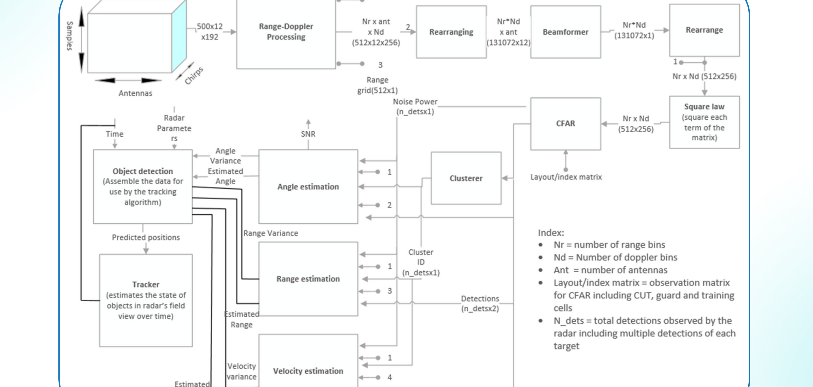

*Signal-processing architecture — cropped from the project defense figure (slide 14).*

## Contents

1. [Executive overview](#1-executive-overview)
2. [Motivation, problem and objectives](#2-motivation-problem-and-objectives)
3. [Project phases and development strategy](#3-project-phases-and-development-strategy)
4. [Radar fundamentals and front-end architecture](#4-radar-fundamentals-and-front-end-architecture)
5. [System-level digital signal processing architecture](#5-system-level-digital-signal-processing-architecture)
6. [Range–Doppler FFT and Hanning window](#6-rangedoppler-fft-and-hanning-window)
7. [Beamforming and angle processing](#7-beamforming-and-angle-processing)
8. [CFAR target detection](#8-cfar-target-detection)
9. [Clustering and target estimation](#9-clustering-and-target-estimation)
10. [Numerical precision, quantization and fixed-point DSP](#10-numerical-precision-quantization-and-fixed-point-dsp)
11. [Radar Designer app experiments](#11-radar-designer-app-experiments)
12. [End-to-end MATLAB simulation results](#12-end-to-end-matlab-simulation-results)
13. [RTL design and simulation evidence](#13-rtl-design-and-simulation-evidence)
14. [Key observations, limitations and next steps](#14-key-observations-limitations-and-next-steps)
15. [Selected figures, sources and repository files](#15-selected-figures-sources-and-repository-files)

## 1. Executive overview

This bachelor’s final-year research project investigated a **frequency-modulated continuous-wave (FMCW) radar processing system** intended for automotive sensing and advanced driver-assistance systems (ADAS). FMCW radar transmits a frequency-swept signal and analyzes the returning echo to estimate the **distance (range)** and **relative radial speed (Doppler)** of objects. Multiple antenna channels can also be combined to estimate or emphasize object direction.

The main engineering emphasis was the **digital signal processing (DSP) architecture**: constructing radar scenes and evaluating an end-to-end processing chain, then breaking it into independently understandable functional units. The defense describes a **modular MATLAB floating-point simulation** using range–Doppler FFT, beamforming, CFAR, clustering and estimation, plus **quantization modeling** for hardware-oriented work. RTL/FFT architectural diagrams, simulated detection outputs and waveforms are also documented. The project overview identifies **Xcelerium** as the external project source; that description is reported from the defense slide, not an independently verified affiliation.

**Core DSP flow:**

```text
Radar transmission → propagation and reflections → mixer/IF beat signal → ADC
    → Hanning window → range FFT → Doppler FFT → range–Doppler cube
    → antenna-channel beamforming → detection power → CA-CFAR
    → detection clustering → range/velocity/angle estimation → tracking concept
```

The architecture figures below come directly from the original final-defense presentation.


*Complete signal-processing block diagram — final defense, slide 14.*

## 2. Motivation, problem and objectives

Autonomous driving and driver-assistance applications need timely estimates of where objects are and how quickly they are approaching or moving away. Camera and ultrasonic sensors have different limitations—particularly low visibility and direct radial-velocity measurement—which motivate complementary radar sensing. The project aimed to explore an automotive radar chain capable of producing detection and target-motion estimates in simulation.

**Project objectives supported by the report and defense:**

- Review commercial radar front-end designs and system parameter trade-offs.
- Model the received/intermediate-frequency waveform and radar scenes.
- Produce range–Doppler responses using fast-time and slow-time transforms.
- Combine antenna responses with beamforming.
- Detect target candidates with an adaptive **constant false alarm rate (CFAR)** stage.
- Group neighboring detections and obtain range and velocity estimates.
- Explore floating-point, quantized/fixed-point and RTL-oriented versions of computational blocks.
- Present controlled scenario outputs, DSP block diagrams and waveform simulations.


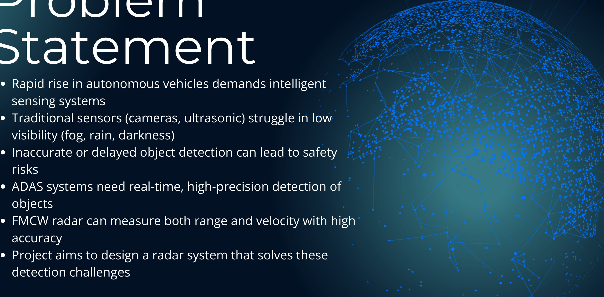

*Problem statement and motivation — final defense, slide 5.*

## 3. Project phases and development strategy

The defense groups the work into **five project phases**, from learning the radar system to RTL-oriented design. The four *architectures* discussed in the thesis are related but not identical to this five-phase project plan.

| Defense phase | Focus | What to look for |
|---|---|---|
| Phase 1 | Understand radar architecture, hardware front ends and processing trade-offs | Design-space exploration |
| Phase 2 | End-to-end simulation with self-defined functions | MATLAB model and functional blocks |
| Phase 3 | Floating-point simulation | Range–Doppler, beamforming, CFAR, estimation |
| Phase 4 | Fixed-point simulation and precision modeling | Word lengths, scaling and quantization effects |
| Phase 5 | RTL design and interfacing concepts | FFT processing RTL diagrams and simulation screenshots |

**Scope clarification:** Defense slide 13 specifically says *simulation only — no hardware implementation* for the custom DSP design. RTL block diagrams and simulator results are separately presented in the deck; this repo does **not** assert that a complete radar was deployed on a physical FPGA or connected to a real automotive front end.


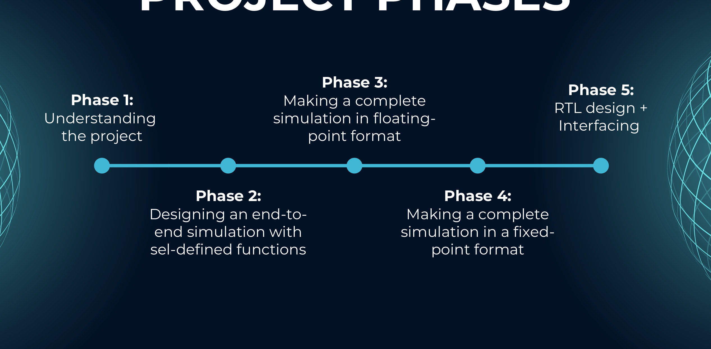

*Five project phases timeline — final defense, slide 6.*

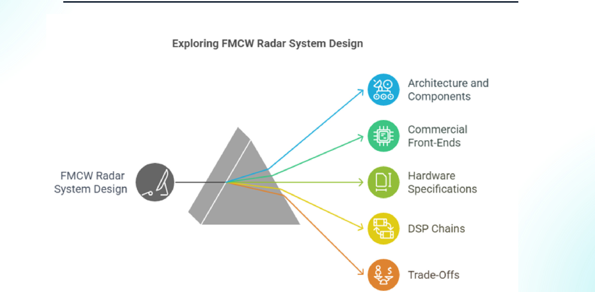

*Design-space exploration and trade-offs — final defense, slide 9.*

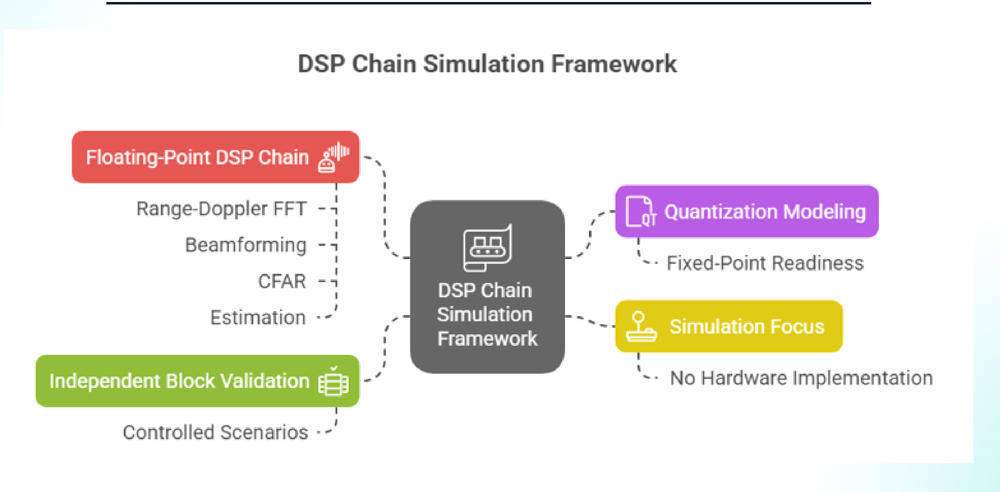

*DSP simulation methodology — final defense, slide 12.*

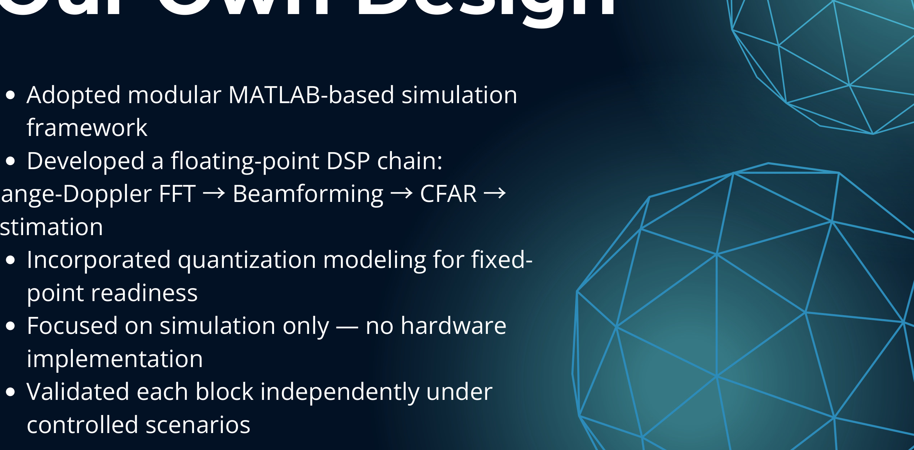

*Custom floating-point MATLAB design and scope — final defense, slide 13.*

## 4. Radar fundamentals and front-end architecture

The transmit waveform is a frequency sweep (chirp). The echo experiences a delay related to range and a Doppler shift related to radial motion. A receiver mixes the return with a reference chirp to form an intermediate-frequency or **beat signal**. Digitized beat samples are subsequently processed by the DSP blocks.

For a linear chirp with sweep bandwidth **B**, sweep duration **T**, slope **S = B/T**, speed of light **c**, and beat frequency associated with target delay **f_b**, a simple single-target approximation is:

- **Range:** `R ≈ c × f_b / (2 × S)` (when Doppler coupling is ignored or compensated).
- **Ideal range resolution:** `ΔR ≈ c / (2 × B)`.
- **Wavelength:** `λ = c / f_c`; Doppler shift relates to radial speed as `f_D ≈ 2v/λ` for monostatic radar.

These formulas provide conceptual context; the thesis uses multiple simulations and configurations rather than one universal setup.

### Baseline design parameters from the thesis (Table 1, thesis PDF page 13)

| Parameter | Reported setting |
|---|---:|
| Center frequency | 77 GHz |
| Sweep bandwidth | 150 MHz |
| Sweep time | 7.33 μs |
| Sampling frequency | 150 MHz |
| Maximum target distance | 200 m |
| Range resolution target | 1 m |
| Maximum speed | 230 km/h |
| Maximum beat frequency | 27.30 MHz |
| Fast-time samples | 1024 |
| Slow-time samples | 256 |

The radar-design app experiments later in the deck explicitly compare other bandwidth settings (1, 2, and 5 GHz). Those are **different experiments**, not changes to be silently merged into the above baseline. Likewise, the block-level simulation slide uses 500 fast-time samples, 192 slow-time samples, 12 antenna channels, 512 range bins and 256 Doppler bins.


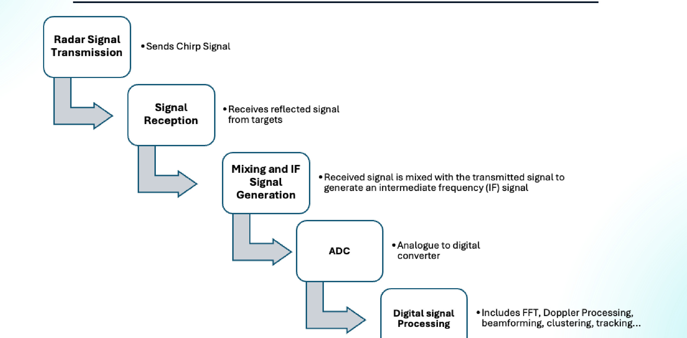

*Front-end process flow: transmit, receive, mixing, ADC and DSP — final defense, slide 10.*

## 5. System-level digital signal processing architecture

The full design is modular. Input data are arranged as a multidimensional radar cube (fast time × antenna × slow time); the pipeline transforms these into detections and object properties. Independent blocks simplify validation, help locate numeric errors and provide an architectural reference for future FPGA work.

1. **Range–Doppler processing:** window and transform fast-time and slow-time sample dimensions.
2. **Beamforming:** apply array steering weights and coherently combine antenna data.
3. **Detection:** create power estimates and compare cells with locally estimated background noise.
4. **Clustering:** associate nearby detections with common targets.
5. **Estimation:** convert detected bins into range and radial-velocity estimates and report uncertainty measures.
6. **Tracking concept:** maintain target estimates over repeated observation frames; the presentation does not provide a complete reproducible production-grade tracker implementation.


*Original complete DSP processing architecture — final defense, slide 14.*

## 6. Range–Doppler FFT and Hanning window

**Range processing:** apply a Hann/Hanning window to fast-time samples and compute a Fourier transform along each chirp to identify beat-frequency peaks associated with distance. **Doppler processing:** stack successive chirps and apply a second transform across slow time to resolve periodic inter-chirp phase variations associated with target motion.

The defense’s block interface uses a radar data cube, with example values **500 fast-time samples × 12 antenna channels × 192 slow-time chirps**; its FFT example pads or maps outputs to **512 range bins × 256 Doppler bins**. The generated axes then translate transformed bins into range and velocity coordinates. Zero-padding improves interpolation/grid density but does not by itself improve the physical resolution imposed by bandwidth or coherent observation time.

**Hanning window:** the window weights sample endpoints less strongly to reduce sidelobe leakage; the trade-off is a wider main lobe and a change in amplitude scaling. The defense includes a separate sub-block for dimension/length-aware window generation.


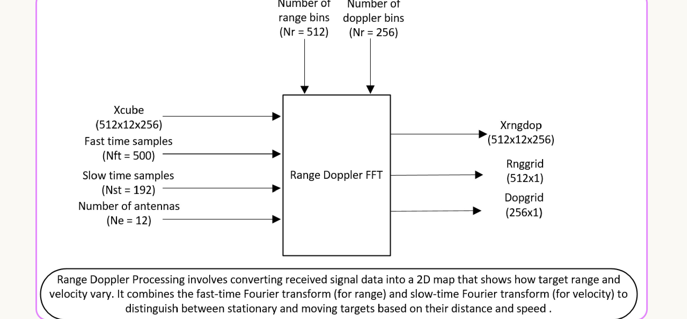

*Range–Doppler FFT input and output interface — final defense, slide 25.*

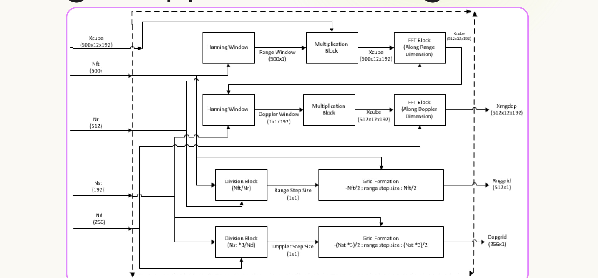

*Internal range–Doppler processing design with two FFT stages — final defense, slide 26.*

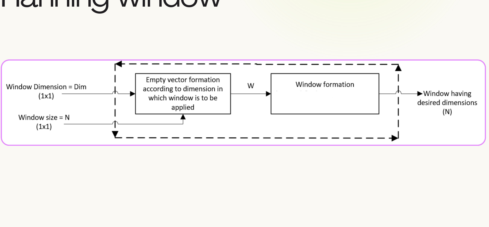

*Hanning window generation block — final defense, slide 27.*

## 7. Beamforming and angle processing

A multiple-antenna receive array records spatial phase differences. For a selected look direction, the **steering vector** accounts for carrier wavelength and antenna spacing. By weighting and coherently combining antenna channels, the conventional beamformer emphasizes signals arriving from the desired direction. The original defense presentation describes steering toward **0°** in one illustrative case.

The block diagram describes reshaping the data into a matrix of range–Doppler cells by antennas, applying a **12-element steering vector**, and reshaping the result to a two-dimensional beamformed map. Specifically, a **512 × 12 × 256** cube corresponds to **131,072 × 12** prior to antenna combination and **512 × 256** afterward. This operation helps simplify subsequent detection and can improve gain for signals aligned with the look direction.


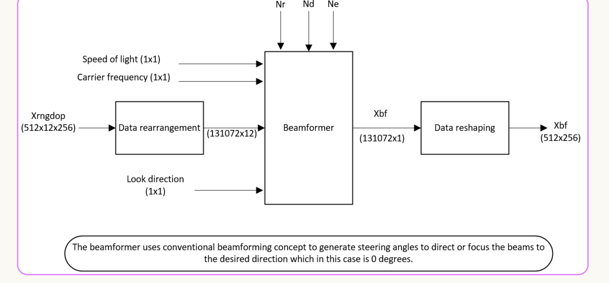

*Beamformer block interface and dimensions — final defense, slide 28.*

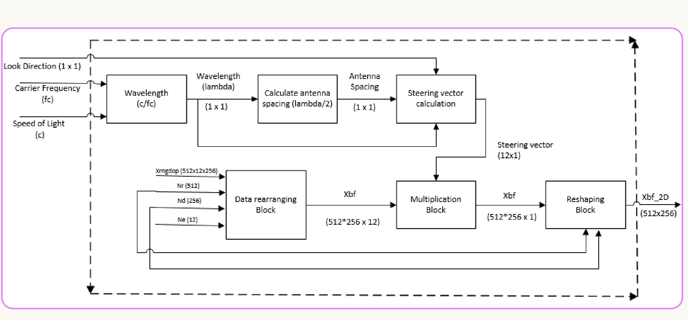

*Beamformer internals: wavelength, array spacing, steering weights and reshaping — final defense, slide 29.*

## 8. CFAR target detection

A global fixed threshold can fail when noise varies across the range–Doppler map. **Cell-Averaging CFAR (CA-CFAR)** instead estimates local background power from *training cells* surrounding each **cell under test (CUT)**, omitting nearby *guard cells* to reduce target leakage into the noise estimate. The estimated noise is scaled by a threshold multiplier, and cells above this value are declared candidates.

**Inputs described on the slides:** a **512 × 256** detection-power map, guard/training layer settings, grid dimensions and a custom threshold factor. **Outputs:** the list of detection indices, number of detected cells and their power/noise-related attributes. The thesis methodology names training/guard configurations of **8×8** and **4×4** respectively; exact border behavior and detection counts can vary with the implemented configuration and scenario.

CFAR detections are **candidate radar returns**, not yet necessarily one unique physical object per detection. That distinction motivates clustering.


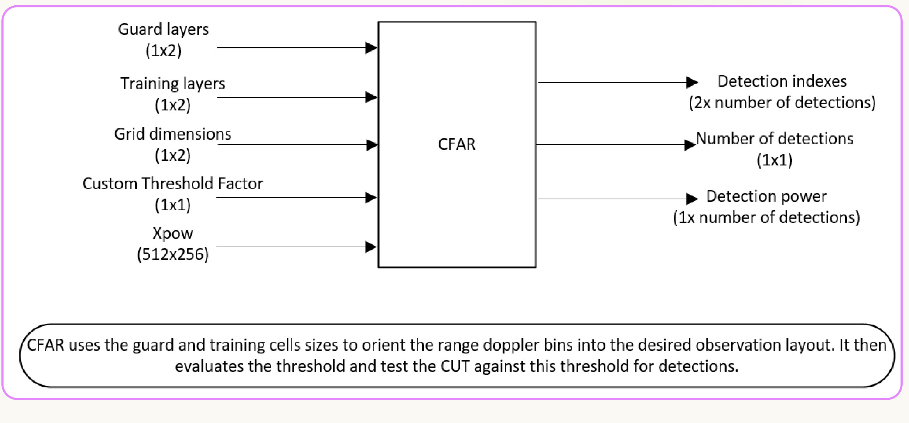

*CFAR functional inputs and outputs — final defense, slide 30.*

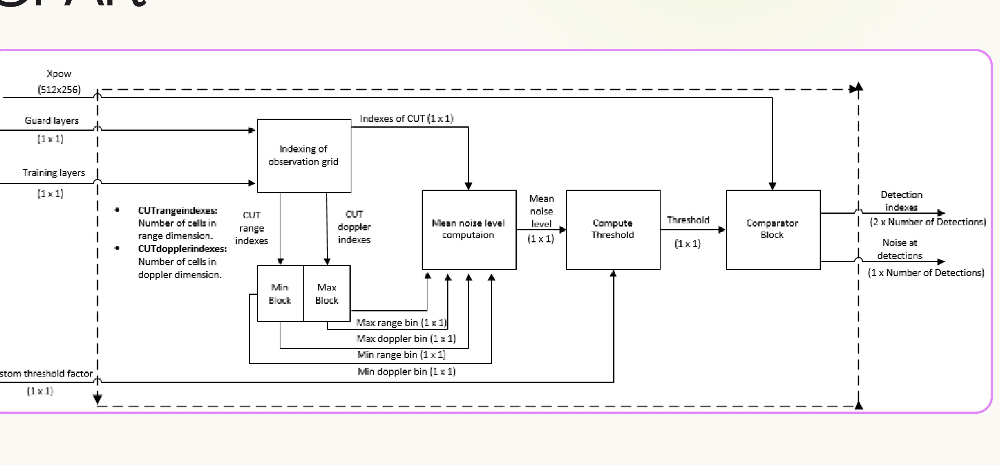

*Internal CFAR training-cell, threshold and comparator flow — final defense, slide 31.*

## 9. Clustering and target estimation

The **clusterer** groups detections whose separation is below an adjustable epsilon-distance threshold. Each detection is assigned a cluster ID, and the resulting cluster count becomes an input to estimation. The deck’s diagrams show registers/point-comparison logic and an update/assign-cluster path.

**Range estimator:** for each cluster, map detections to their range-grid coordinates, read the corresponding beamformed magnitudes, and form a magnitude-weighted estimate of target range. A range variance is also calculated as a measure of spread.

**Doppler/velocity estimator:** the same general idea is applied to Doppler-grid values, producing one velocity estimate and a variance per cluster. This processing is a post-detection measurement step; a distinct across-frame tracking algorithm would be needed for identity continuity in a live deployment.


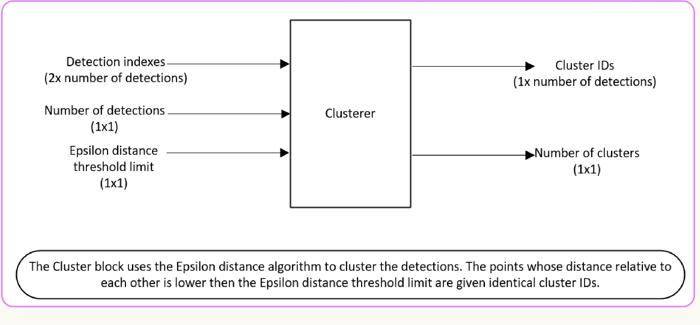

*Cluster block interface — final defense, slide 32.*

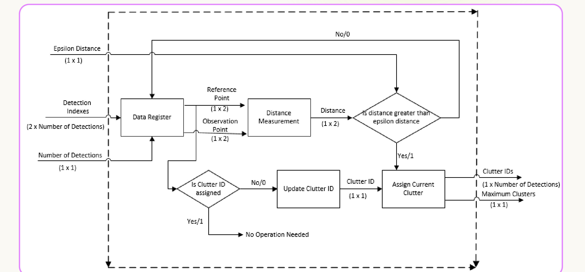

*Cluster internals and epsilon-distance logic — final defense, slide 33.*

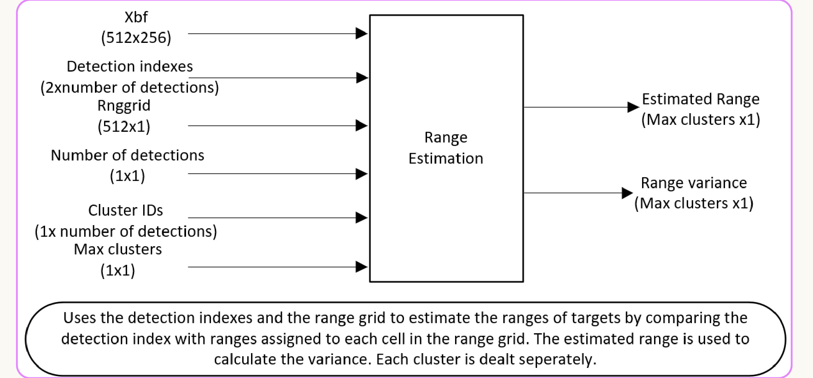

*Range-estimation block inputs and outputs — final defense, slide 34.*

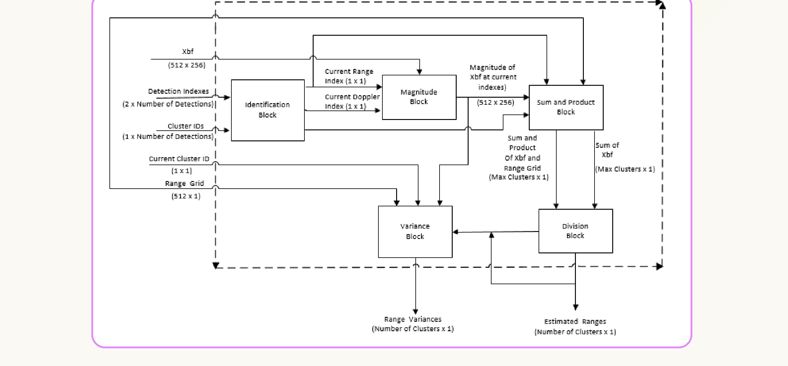

*Range estimator weighted aggregation — final defense, slide 35.*

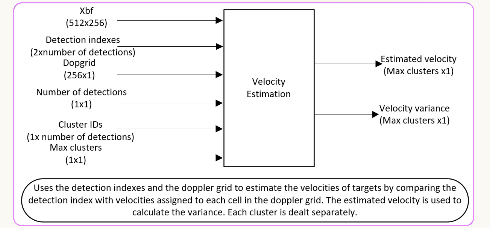

*Velocity-estimation block inputs and outputs — final defense, slide 36.*

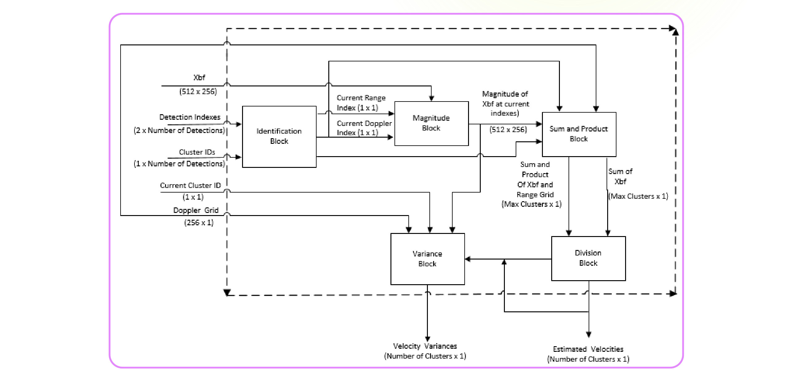

*Velocity estimator weighted aggregation — final defense, slide 37.*

## 10. Numerical precision, quantization and fixed-point DSP

The thesis distinguishes **full floating-point modeling**, **quantized floating-point signals**, and **fixed-point-oriented design**. A floating-point simulation is useful for creating an algorithmic reference before area, overflow and arithmetic bit-width constraints are imposed. Quantization experiments approximate the loss of precision caused by finite word length. The thesis discusses 12- and 16-bit emulated quantization at intermediate stages, and **Q1.15** (signed 16-bit with 15 fractional bits) as a target format for fixed-point DSP and RTL work.

Key design issues include:

- **Dynamic range and clipping:** scaling must keep values within the representable numeric interval.
- **FFT butterfly bit growth:** sums/differences can increase magnitude, demanding wider registers or staged shifts.
- **Multiplication:** product precision may need 2× operand width before rounding or truncation.
- **Quantization noise:** the output is compared against a higher-precision reference, potentially using SQNR and range/velocity errors.
- **Resource trade-offs:** numeric width influences registers, multipliers, memory and practical FPGA implementation.

The defense discusses floating-point quantization and fixed-point processing separately. The relevant selected figure crops are included below, but these images alone do not establish measured performance figures.


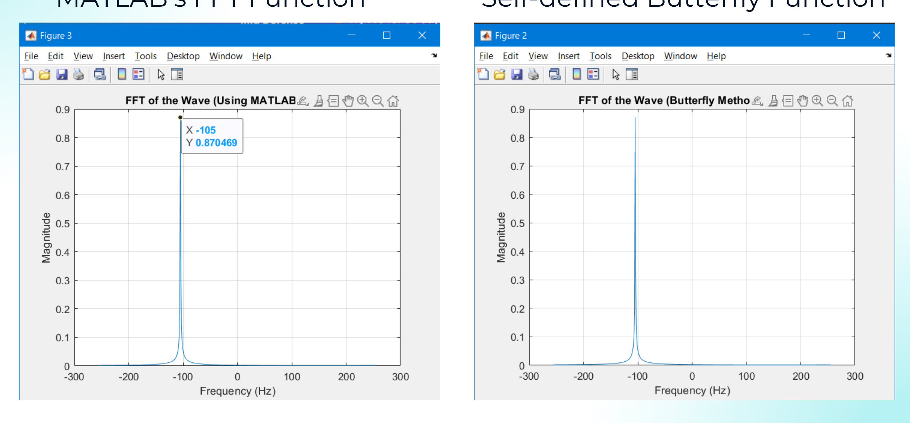

*Comparison of MATLAB FFT and self-defined butterfly function — final defense, slide 98.*

## 11. Radar Designer app experiments

The defense includes a substantial **MATLAB Radar Designer** exploration comprising parameter settings, environment conditions and performance visualizations for multiple radar designs. These app plots are **design-space and simulation evidence**, not measurements from an installed automotive radar.

For three labeled example radars, the slides give:

| Example | Carrier | Bandwidth | Transmit peak power | Chirp/pulse width | Noise figure |
|---|---:|---:|---:|---:|---:|
| Radar no. 1 (slides 40–46) | 77 GHz | 1 GHz | 30 mW | 26 μs | 12 dB |
| Radar no. 2 (slides 47–53) | 77 GHz | 2 GHz | 30 mW | 26 μs | 12 dB |
| Radar no. 3 (slides 54–60) | 77 GHz | 5 GHz | 30 mW | 26 μs | 12 dB |

The slides additionally show PRIs, antenna gains, environment and target settings. Comparisons include **SNR vs range, probability of detection vs range, environmental loss, range–Doppler coverage, scenario geometry, antenna radiation pattern, link budget, probability of detection vs SNR, and resultant metrics**.

Additional radar design comparisons appear in the original defense materials; the repository focuses on representative figures that support the technical explanation. Similar slide titles recur across different experiment configurations.


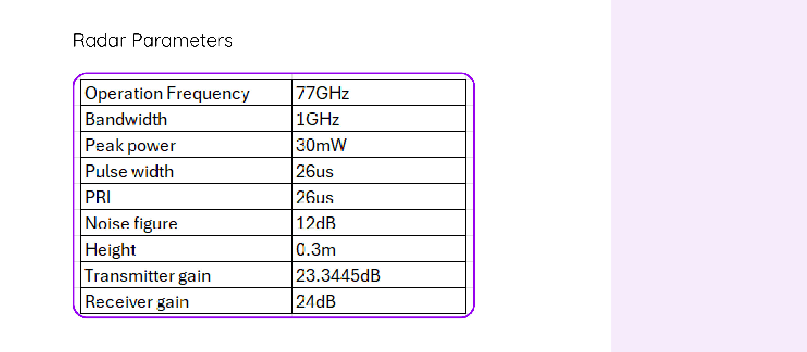

*Radar Designer: design 1 parameters (1 GHz) — final defense, slide 40.*

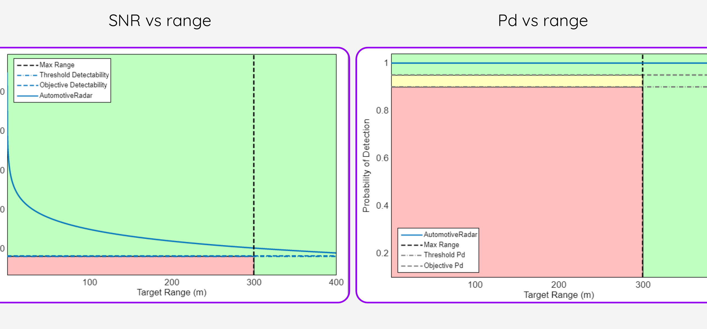

*Radar Designer: SNR and detection probability versus range — final defense, slide 42.*

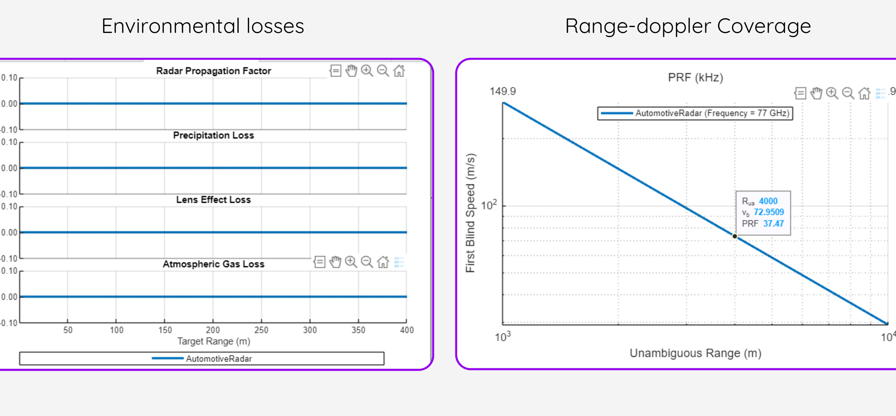

*Radar Designer: losses and range–Doppler coverage — final defense, slide 43.*

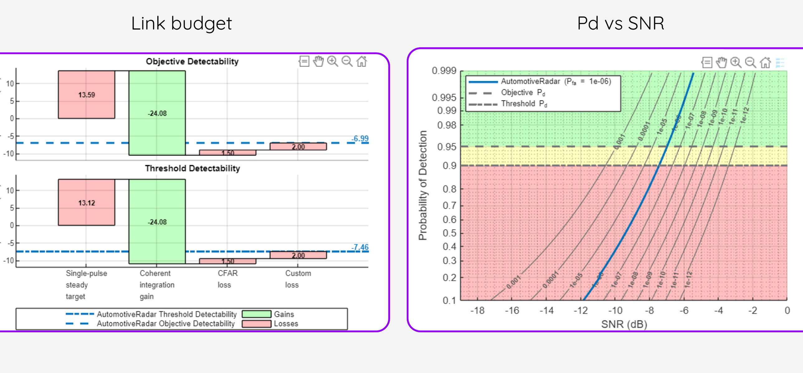

*Radar Designer: link budget and Pd versus SNR — final defense, slide 45.*

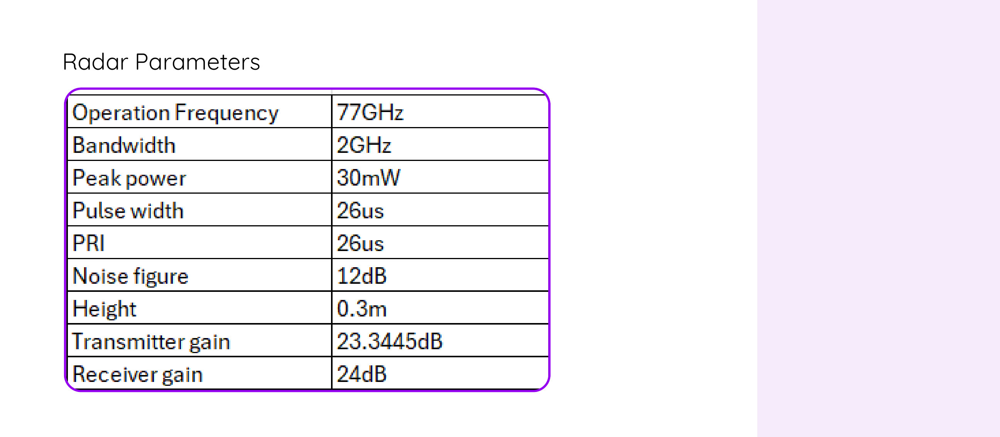

*Radar Designer: design 2 parameters (2 GHz) — final defense, slide 47.*

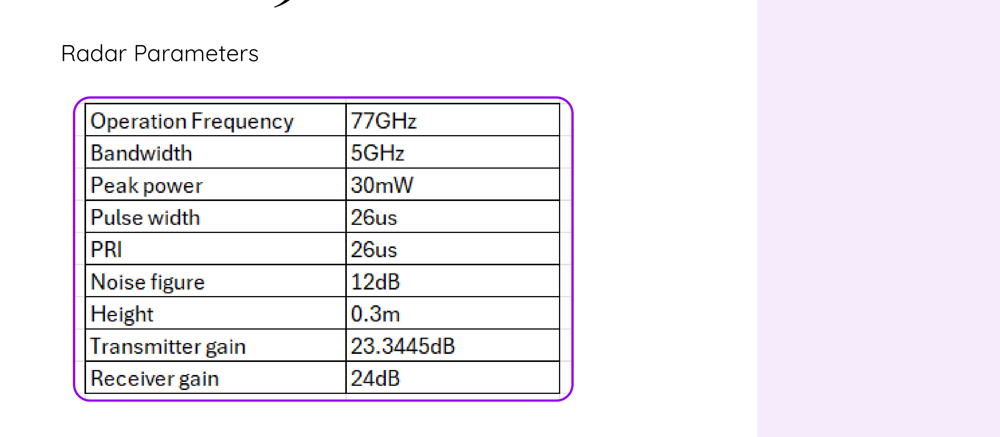

*Radar Designer: design 3 parameters (5 GHz) — final defense, slide 54.*

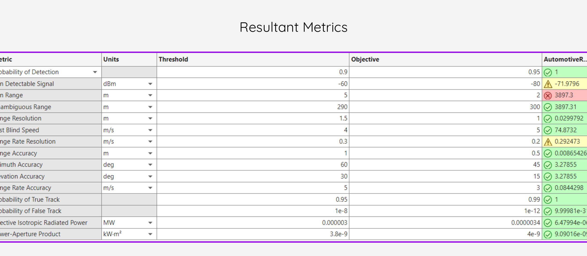

*Radar Designer: design 3 resultant metrics — final defense, slide 60.*

## 12. End-to-end MATLAB simulation results

The original defense presentation describes a **Texas Instruments AWR-parameter-inspired simulation**, using a free-space environment with **one ego vehicle and three targets**, a **2-second** scenario and **0.05-second time steps**. These are model conditions from the deck; no original data-cube `.mat` files accompany the uploaded PDFs.

The simulation plots walk through the chain in sequence: transmitted signal; received signal; mixed IF signal; range–Doppler transform; beamformed response; beamformed power map; CFAR detections; clusters; and final range/velocity estimates at representative early and late times.

### Defense-slide target scenario (slide 15)

The slide lists an ego velocity of **22.22 m/s** and the following recorded outputs (preserved as written in the presentation):

| Target | Reported actual distance | Actual velocity | Actual relative velocity | Reported estimated distance | Estimated relative velocity | Relative SNR |
|---|---:|---:|---:|---:|---:|---:|
| 1 | 20 m | 27.78 m/s | 5.56 m/s | 42.22 m | 5.58 m/s | 4.87 dB |
| 2 | 60 m | 36.11 m/s | 13.89 m/s | 88.89 m | 13.89 m/s | 4.36 dB |
| 3 | −1 m | 30.56 m/s | 8.34 m/s | 23.44 m | 8.33 m/s | 24.73 dB |

The significant discrepancies between listed actual and estimated **ranges**, especially for targets 1 and 2, should not be concealed or treated as a validated accuracy claim. The unusual third input distance is also preserved rather than guessed or silently corrected. The slide demonstrates the project's reported scenario output; more controlled error analysis would be required before drawing precise performance conclusions.


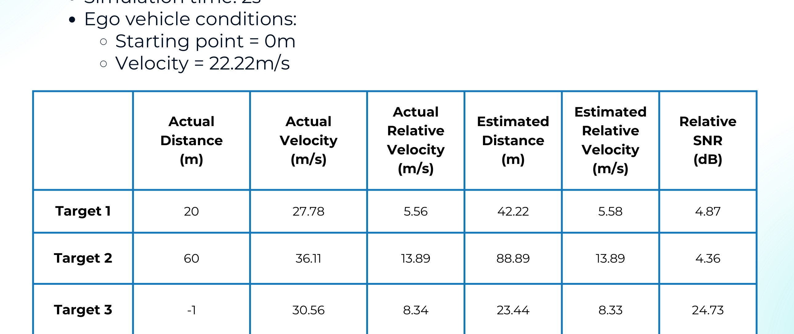

*Three-target test scenario with original actual and estimated values — final defense, slide 15.*

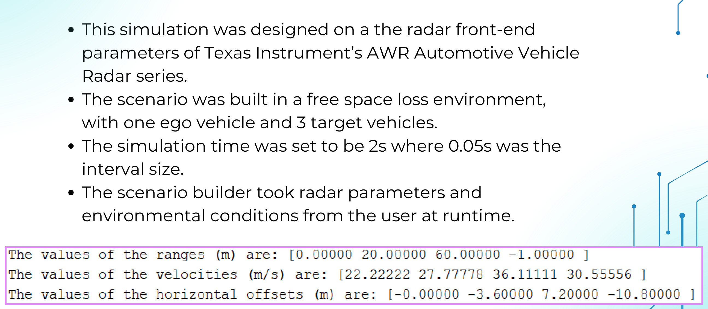

*TI AWR-inspired MATLAB simulation overview — final defense, slide 83.*

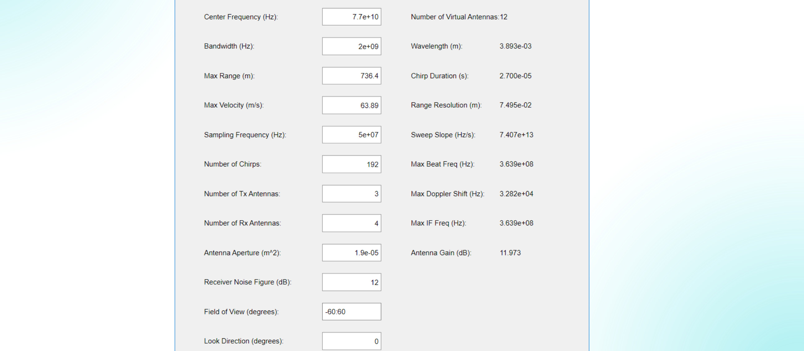

*Radar parameter settings — final defense, slide 84.*

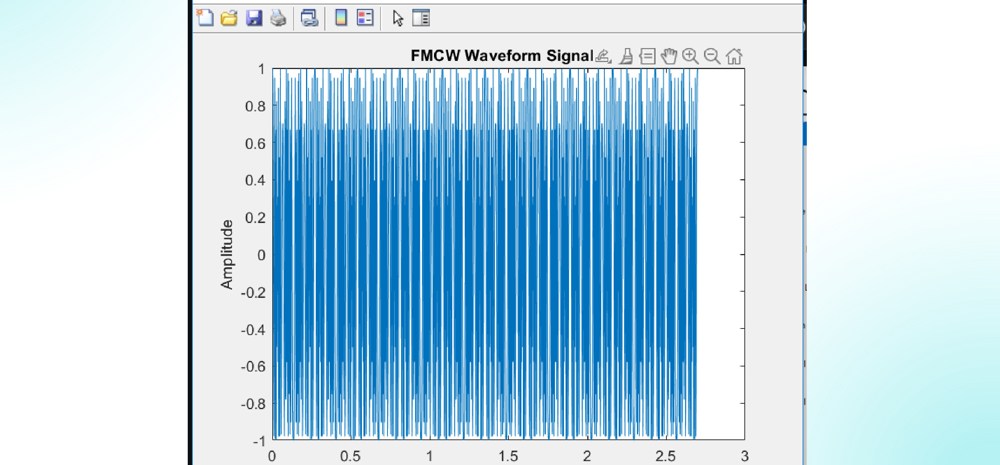

*Transmitted chirp/time-domain signal — final defense, slide 86.*

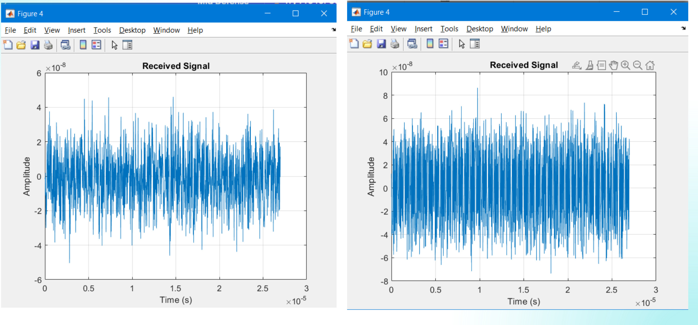

*Received time-domain signals at two instants — final defense, slide 87.*

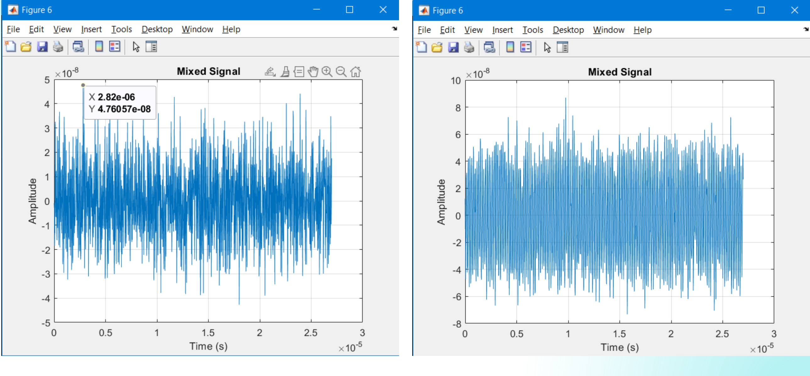

*Mixed IF signal at two instants — final defense, slide 88.*

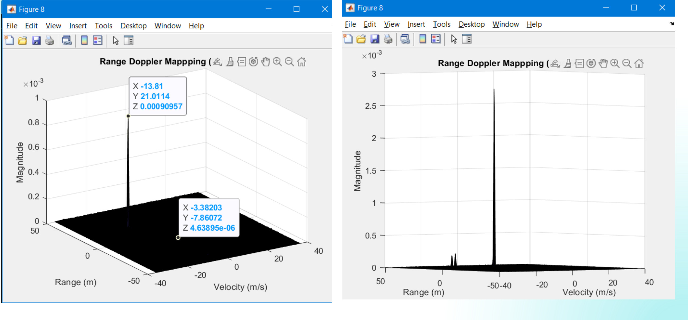

*Range–Doppler response at two instants — final defense, slide 89.*

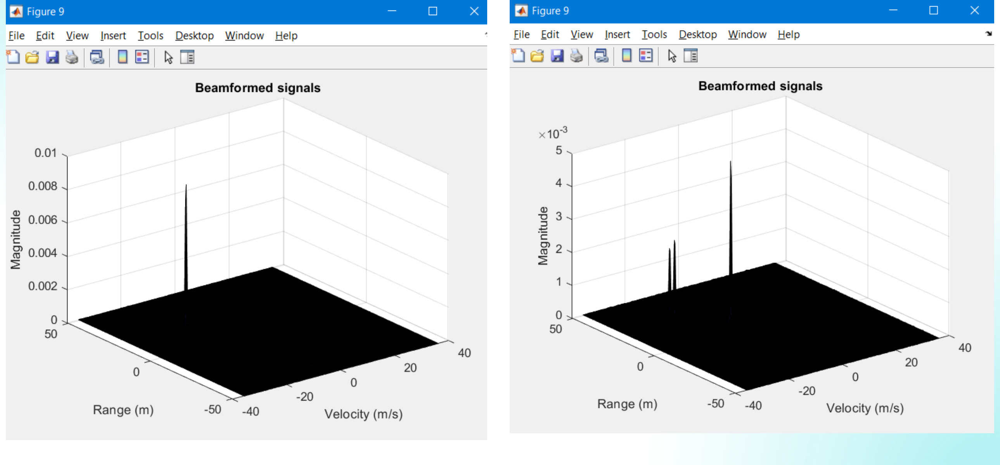

*Beamformed responses at two instants — final defense, slide 90.*

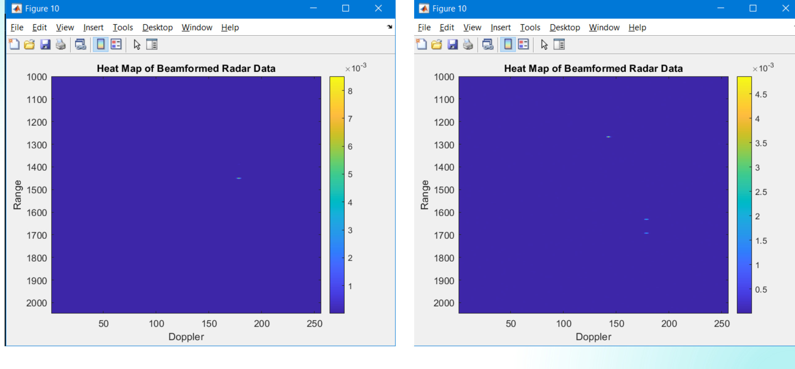

*Beamformed heatmaps — final defense, slide 91.*

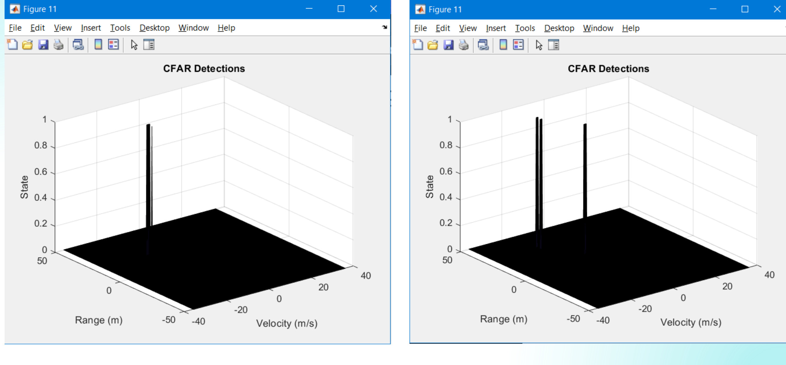

*CFAR target detections — final defense, slide 92.*

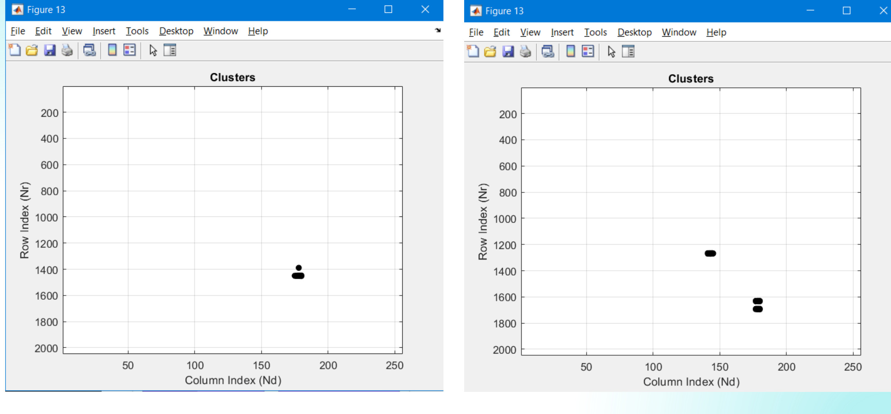

*Detection clusters — final defense, slide 94.*

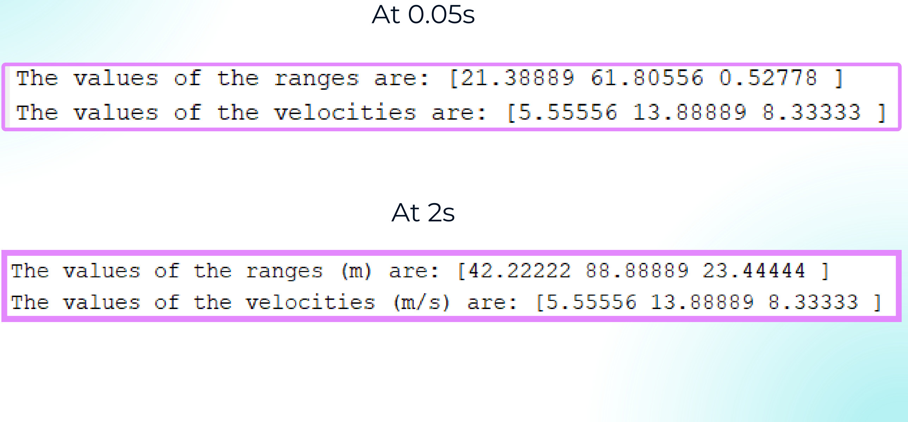

*Estimated ranges and velocities — final defense, slide 95.*

## 13. RTL design and simulation evidence

The defense also shows an **RTL block diagram** for a hardware-oriented range/Doppler FFT processing chain, with range FFT, ping/pong memory buffers, Doppler FFT, window-coefficient storage, magnitude/power detection, CFAR and control logic. Later slides describe a Q1.15 **FFT processor** design consisting of fixed-point adder, multiplier, multiplexers, FFT/window/accumulator RAM, butterfly and accumulator units, and controller.

The presentation includes **Vivado/RTL simulator waveform screenshots** and textual detections for one- and two-target scenarios. These are *reported simulation results*, not hardware measurements. For example:

- **Slide 18:** ego 30 m/s, target at 50 m moving 50 m/s. Listed detections include `(48.83 m, 18.24 m/s)`, `(50.78 m, 22.80 m/s)`, `(52.73 m, 22.80 m/s)`.
- **Slide 20:** adds a second target at 70 m moving 70 m/s; detections near **70.31 m** and **72.27 m** are additionally listed, both at **41.03 m/s**.
- **Slides 19 and 21:** RTL simulator traces show register-level/detection output activity.

The spread of multiple detections around one nominal target is visible in the source outputs and should not be reported as one-to-one perfect target localization. The files required to synthesize or rerun the RTL are not included in the supplied presentation and thesis PDF.


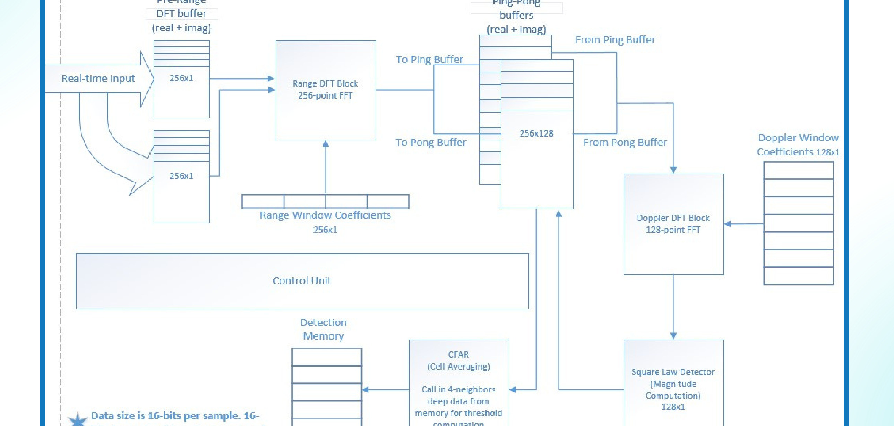

*RTL architecture diagram with ping/pong FFT buffering — final defense, slide 17.*

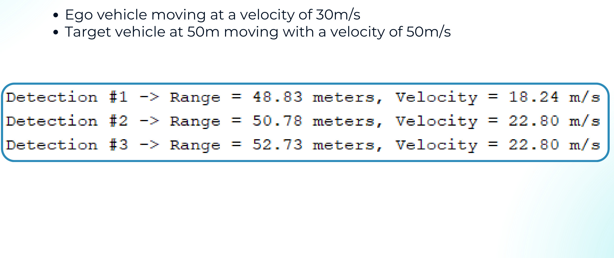

*RTL single-target simulation detections — final defense, slide 18.*

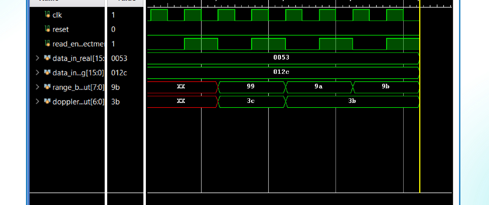

*RTL simulator waveform example — final defense, slide 19.*

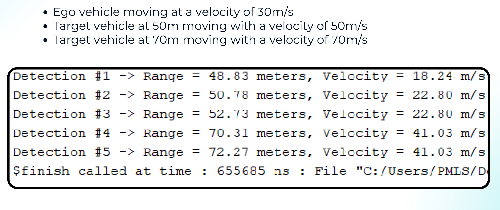

*RTL two-target simulation detections — final defense, slide 20.*

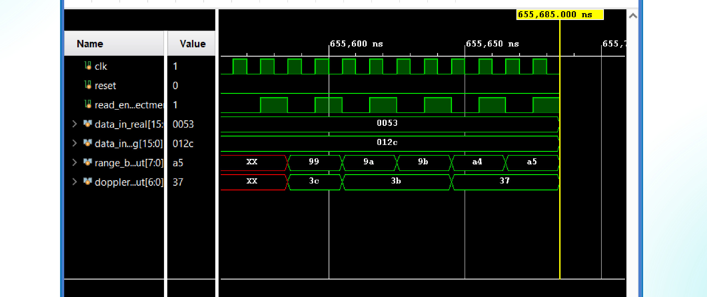

*RTL simulator waveform for two targets — final defense, slide 21.*

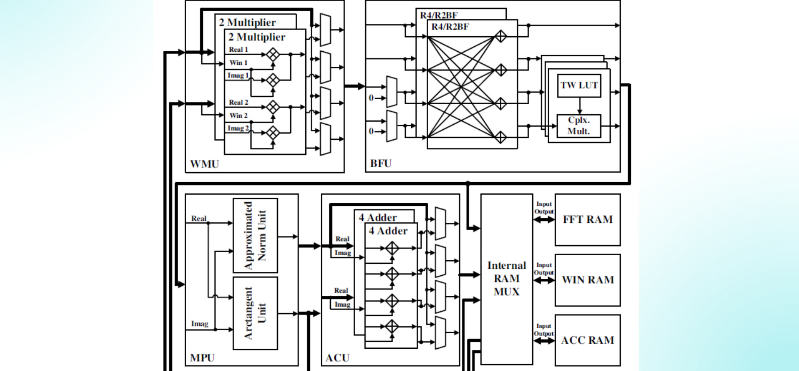

*RTL reference design — final defense, slide 109.*

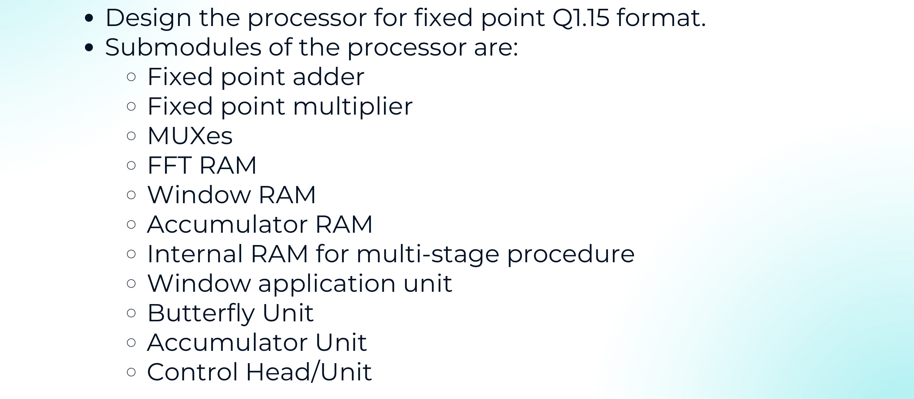

*Q1.15 hardware FFT processor specifications — final defense, slide 110.*

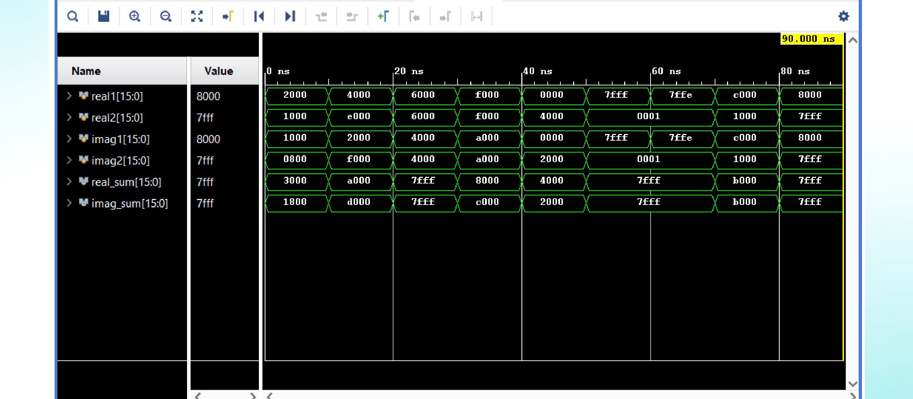

*Fixed-point adder simulation — final defense, slide 111.*

## 14. Key observations, limitations and next steps

**What the academic materials demonstrate:** a large modular set of FMCW radar design studies, explanations and simulated outputs, covering radar configuration, digital range–Doppler/array/detection processing, approximation to finite-precision arithmetic and RTL-oriented block design.

**Important limitations:**

1. **No executable source in the supplied uploads.** The original MATLAB `.m`/`.slx`, Verilog/SystemVerilog source, Vivado `.xpr`, testbenches, waveform databases and numerical raw result files were not supplied. Screenshots cannot be reverse-engineered into an authentic runnable implementation.
2. **Simulation is not physical deployment.** The defense explicitly describes the custom DSP design as simulation-only and its hardware as a later integration path. Do not equate reported RTL simulation with an FPGA demonstration or vehicle-ready system.
3. **Parameter configurations differ.** The baseline thesis Table 1, radar-app bandwidth experiments and block-diagram FFT sizes represent different configurations; they are not a single internally identical run.
4. **Scenario accuracy varies.** Original slides show differing actual and estimated distances, multiple candidate detections per target and outputs requiring calibration/association.
5. **Claims of comparative superiority** over other sensing modalities would need matched experimental datasets, baselines and repeatable metrics before being treated as a general established performance result.

**Possible extensions:** add MATLAB source and parameters; provide deterministic radar cubes; compare range/velocity errors across SNR, weather and precision modes; validate CFAR Pd/Pfa with many repeated trials; provide verified RTL testbenches and post-synthesis utilization reports; implement a reproducible hardware-in-the-loop experiment; and add temporal tracking/association tests.

## 15. Selected figures, sources and repository files

All images embedded above are local repository files under `assets/figures/`. They display on GitHub only when that folder is uploaded with `README.md`. Only the relevant drawings, charts, and result screenshots were extracted; the full final-defense presentation is deliberately excluded.


- **[Complete bachelor's thesis, 203-page PDF](thesis/Bachelors_Thesis_FYP.pdf)**
- [Original thesis figure gallery](docs/10_figure_gallery.md)
- [Signal-processing technical background](docs/03_dsp_pipeline.md)
- [Precision/fixed-point discussion](docs/04_floating_and_fixed_point.md)
- [RTL/FPGA discussion](docs/05_rtl_fpga_architecture.md)
- [Results and critical limitations](docs/07_results_and_discussion.md)
- [Source-file availability and reproducibility](docs/09_source_availability_and_reproducibility.md)
- [GitHub upload guide](GITHUB_UPLOAD_INSTRUCTIONS.md)

### Files and publication guidance

| Location | What it contains |
|---|---|
| `README.md` | Full illustrated GitHub project narrative |
| `assets/figures/defense_*.jpg` | Selected cropped project figures extracted from the defense presentation; referenced directly in this README |
| `assets/figures/` | Diagrams/figures extracted previously from the thesis |

| `docs/01_…` to `docs/10_…` | Separate background, methods, results and limitations |
| `thesis/` | Original 203-page bachelor's thesis PDF only |
| `hardware/` | Documentation and placeholders, **not** claimed to contain original HDL |

**Attribution:** this is a *team bachelor's thesis*, with original diagrams, photographs/screenshots and research work belonging to their appropriate authors. Please obtain relevant coauthor, university and external-project permissions before publishing materials publicly. This repository does not assert an open-source license or redistribute unsupplied program source.
