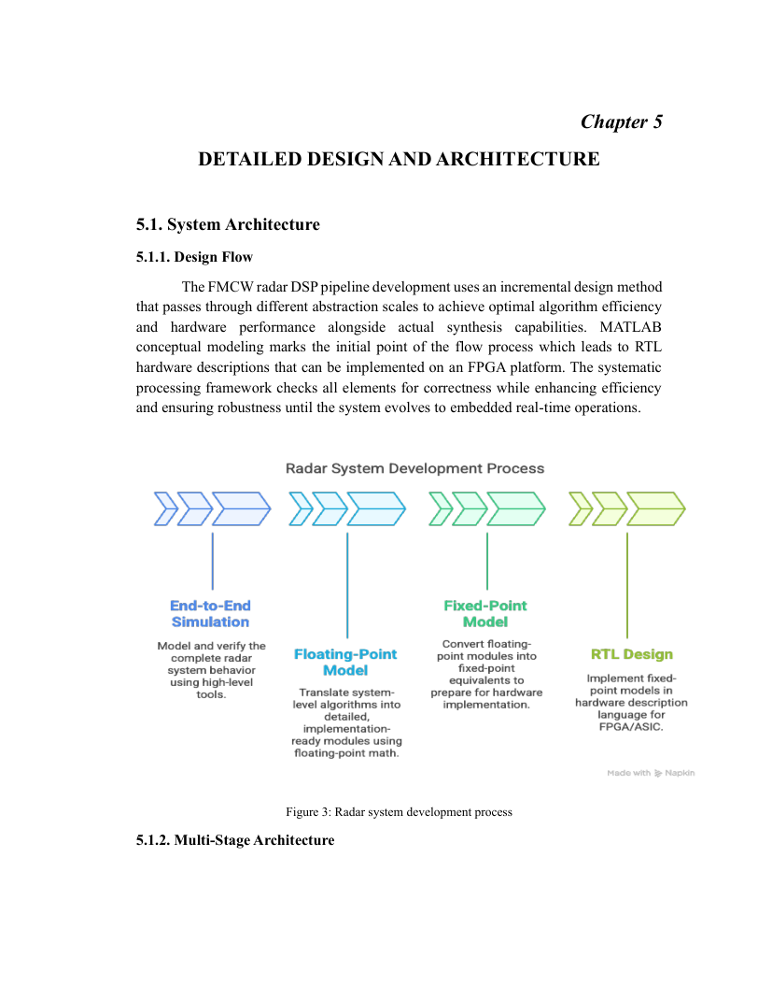

# Background, motivation and objectives

**Source:** Thesis chapters 1–3, pages 7–11.

## Motivation

Automotive perception needs reliable obstacle detection and estimates of distance and relative speed. Optical sensors are impacted by low illumination and low visibility; ultrasonic sensors are typically most useful over comparatively short ranges. A 77 GHz FMCW radar is a complementary active sensing technology, providing direct range-related and Doppler-related measurements through reflected radio waves.

## Research problem

The thesis focuses on the signal processing stages between a modeled or commercially inspired radar front end and useful target detections. The challenge is not only obtaining range–Doppler estimates under noise, but also considering constraints that arise when translating floating-point processing into hardware-friendly arithmetic and ultimately RTL modules.

## Project objectives, as set out in the report

1. Design a digital processing pipeline incorporating time-domain analysis, range FFT, Doppler FFT, adaptive detection, beamforming, clustering and target estimation.
2. Develop a simulation environment with target and environment variation and configurable radar parameters.
3. Construct a floating-point reference and examine fixed-point quantization, overflow and numerical loss.
4. Build hardware-oriented RTL representations for DSP modules and use FPGA tools for resource and timing evaluation.
5. Examine detection reliability, accuracy and computational requirements, with relevance to ADAS.

## Scope

The report uses front-end parameters inspired by **Texas Instruments AWR** and **NXP** automotive radar offerings. Its focus is the processing chain rather than manufacturing a radio-frequency sensor module. It discusses a Nexys A7-100T FPGA target and RTL verification, but does not supply executable hardware bitstreams or raw project files with the PDF.

## Four-layer development model

The report describes progressive abstraction: a library-based simulation, a custom floating-point chain, a hardware-aware fixed-point chain, and RTL. These stages allow functional baselines to be established before increasing hardware constraints.

## Academic context

Degree: Bachelor of Electrical Engineering, SEECS, NUST Islamabad, 2025. Authors: Muhammad Ahmad Nazir, Dania Farrukh Ghouri and Zunaira Aziz. Advisor: Dr. Shahzad Younis; co-advisor: Dr. Arbab Latif. Full primary source is in `thesis/`.
