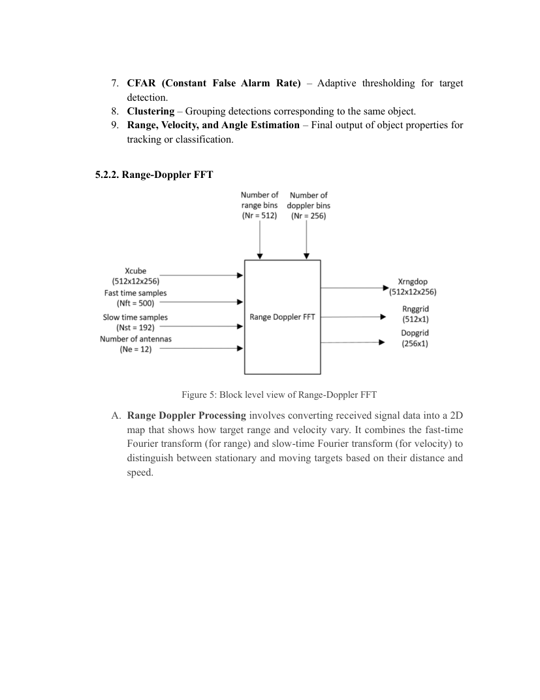

# FMCW radar foundations and design parameters

**Sources:** Thesis §§2.2–2.4, 4.2–4.3, 5.2.2 and Table 1 on PDF page 13.

## FMCW waveform and beat frequency

An FMCW radar transmits a continuous waveform whose instantaneous frequency changes with time during a chirp. The receiver compares the returned waveform to a reference copy, producing an intermediate-frequency **beat signal**. For an ideal stationary target under a linear chirp approximation, beat frequency relates to round-trip delay and range.

The following **standard radar relationships are included for technical explanation**, not asserted as equations explicitly measured by the thesis:

- Chirp slope: `S = B / T_chirp`.
- Approximate round-trip time: `tau = 2 R / c`.
- Stationary-target beat frequency: `f_b ≈ S * tau`.
- Approximate range: `R ≈ (c * f_b) / (2 S)`.
- Ideal bandwidth-limited range resolution: `ΔR ≈ c / (2 B)`.
- Wavelength: `lambda = c / f_c`.
- Monostatic radial Doppler: `f_D ≈ 2 v_r / lambda`.

Here `B` is modulation bandwidth, `T_chirp` is chirp duration, `c` is propagation speed, `R` is range, `f_c` is carrier frequency and `v_r` is signed radial velocity. In moving-target triangular or multi-chirp designs, beat frequency may include Doppler contributions and requires the correct signal model and sign convention.

## Design table — transcribed from thesis

| Quantity | Value from Table 1 |
| --- | ---: |
| Operating frequency | 77 GHz |
| Maximum range | 200 m |
| Range resolution | 1 m |
| Maximum speed | 230 km/h |
| Sweep time | 7.33 μs |
| Bandwidth | 150 MHz |
| Maximum beat frequency | 27.30 MHz |
| Sample rate | 150 MHz |
| Fast-time samples | 1,024 |
| Slow-time samples | 256 |

**Interpretation note:** Table 1 reports a 150 MHz bandwidth and 1 m range resolution, which agree to the usual approximate resolution relationship. Some later block diagrams use 500 fast-time samples, 192 slow-time samples, 512 range bins and 256 Doppler bins (§5.2.2). Those values describe another illustrated data layout and should not be conflated automatically with Table 1.

## Signal-processing dimensions

**Fast time** refers to samples within a chirp; a range FFT extracts spectral peaks associated with delay. **Slow time** refers to sequences across successive chirps; a Doppler FFT measures coherent phase evolution and hence radial motion. Antenna channels provide the spatial dimension for beamforming and angle processing.

The illustrated array processing in §5.2.3 uses **12 antenna channels** and constructs a steering vector before collapsing the channels into a beamformed 2D range–Doppler map.

## Important engineering considerations

- A window (the report uses Hanning/Hann) reduces FFT sidelobes at the cost of main-lobe broadening.
- Zero-padding refines the display/sampling of the spectrum; it does **not** improve the fundamental resolution set by waveform bandwidth or coherent observation time.
- Strong interference, multipath, rain loss, ADC saturation and quantization can impact practical detections.
- Front-end configuration and scene simulations do not alone demonstrate automotive certification or field reliability.
