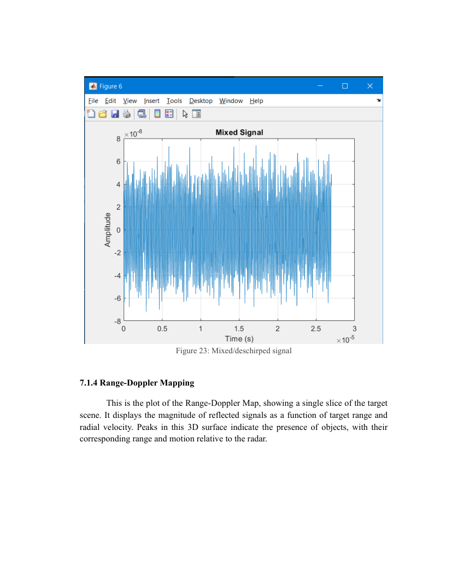
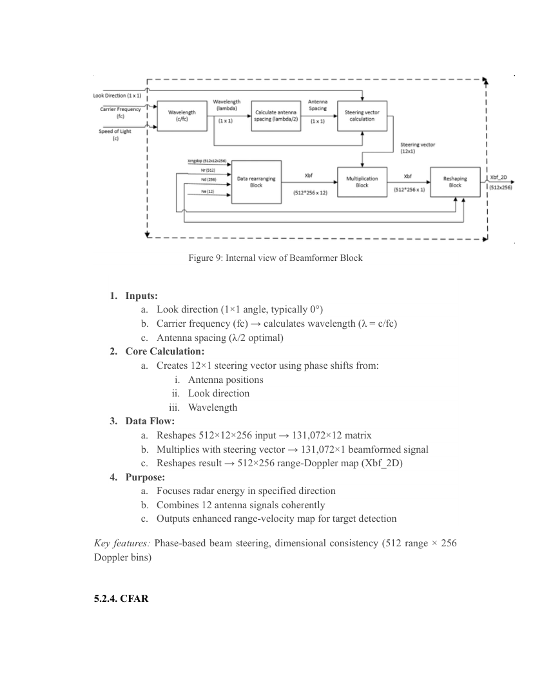
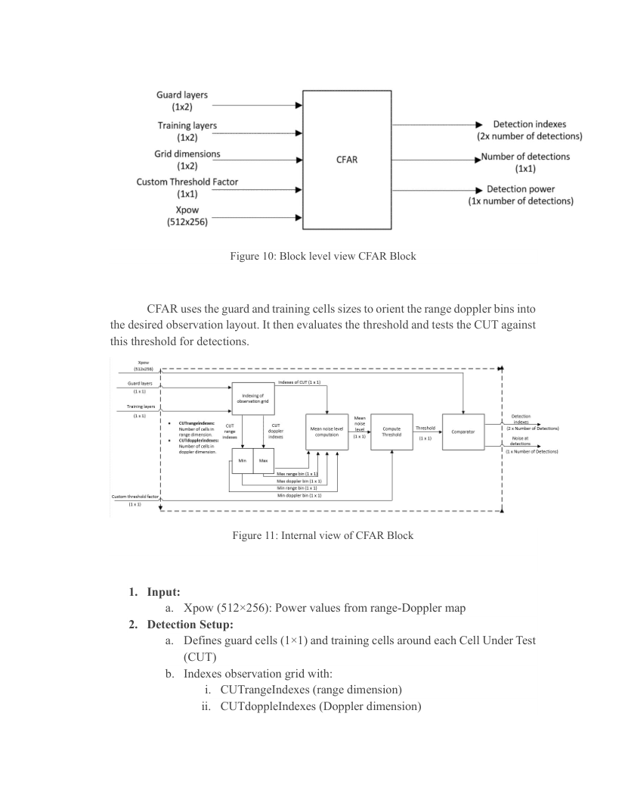
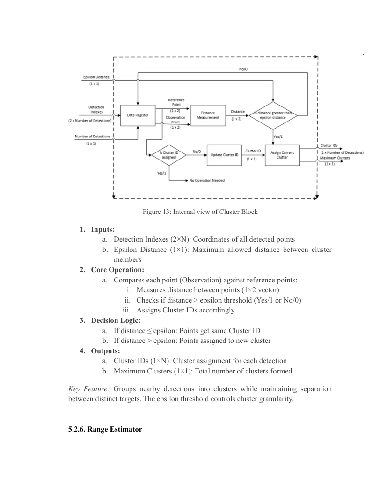

# Detailed digital signal processing pipeline

**Sources:** Thesis §§4.3, 5.2–5.3, 7.1; particularly the processing diagrams on PDF pages 24–34.

## 1. Scene / target model and chirp generation

The reference stage models an FMCW chirp, transceiver, propagation path, and stationary or moving targets. Relative motion changes observed phase across chirps; round-trip delay encodes target range. The simulated receive signal includes attenuation and scenario effects.

## 2. Dechirping, sampling and waveform inspection

A reference signal is mixed with the received waveform, producing the beat/IF signal. The thesis plots the transmitted, received, and mixed signals (Chapter 7, Figures 21–23). Time-domain inspection checks amplitude, sampling and signal content before moving to spectral analysis.

## 3. Range processing

A Hann/Hanning window tapers the fast-time samples to reduce leakage. A range FFT converts each chirp's signal into a frequency-domain profile. The report includes an example using **500 fast-time samples** and **512 range FFT bins** via zero-padding (§5.2.2); other configuration values are given separately in Table 1.

## 4. Doppler processing

Per-range-bin information across successive chirps becomes a slow-time sequence. A second FFT provides Doppler-bin structure. An illustrated design uses **192 slow-time samples** with **256 Doppler bins**. The result is a two-dimensional matrix indexed by range and Doppler velocity.

## 5. Spatial beamforming

The report's conventional beamformer computes phase adjustments from carrier wavelength, antenna spacing and a look direction (the example uses **0°**). A 12-element steering vector coherently combines 12 channels per range–Doppler cell. The figure describes reshaping a `512 × 12 × 256` cube into `131072 × 12`, combining antenna channels, and reshaping the result to `512 × 256`.

## 6. Cell-averaging CFAR detector

CA-CFAR evaluates each **cell under test (CUT)** relative to a local noise estimate computed from surrounding **training cells**. **Guard cells** separate a likely target response from background samples to avoid contaminating the local noise estimate. The methodology lists **8×8 training** and **4×4 guard** cell configurations; the later block diagrams discuss adjustable settings. Detection thresholds are adaptive to the local signal environment.

The reported outputs include detection indices, detection power/noise information, and comparison flags. A useful principle is that CFAR control parameters must be interpreted with their definition (cells per side versus total window width), and threshold scaling must match the assumed signal statistics.

## 7. Clustering

The clustering stage joins detections that lie within a configured **epsilon distance** into groups with shared cluster IDs (§5.2.5). This helps avoid reporting every adjacent range–Doppler detection as a separate target. Threshold units and scaling are important because range and Doppler axes use different units.

## 8. Per-target estimation

Using the location of detections and the associated range/velocity grids, the report describes cluster-wise estimates of range and velocity. The estimators use signal-magnitude weighting and also calculate variance as a dispersion indicator. These estimates are intended as inputs to a downstream tracking or ADAS perception process.

## 9. Visualization and reporting

The thesis shows waveform plots, range–Doppler displays, beamformed outputs, CFAR maps, clusters, and comparative target detections. The repository's figures are rendered from the **original PDF** and are not newly generated from source simulations.

## Output boundaries

This documentation describes algorithms reported in the thesis; it does not expose sample data arrays, executable models, test fixtures, or hardware integration scripts. Those remain needed for exact experiment replication.
