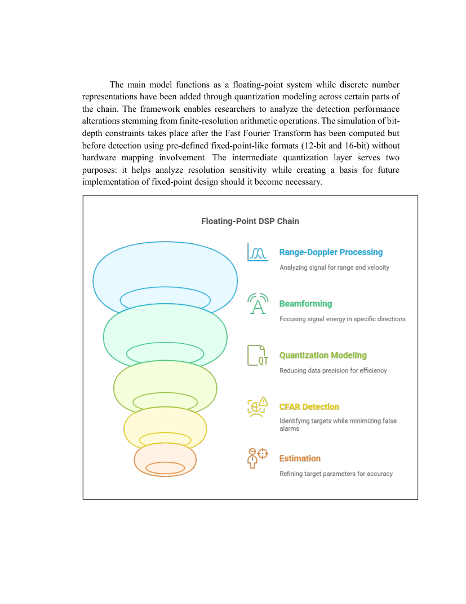
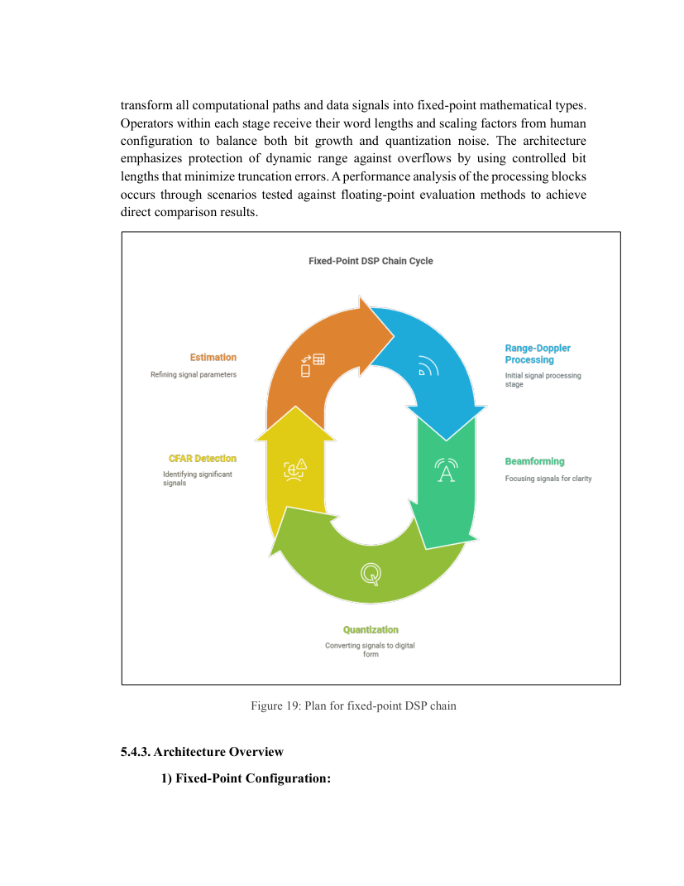

# Floating-point validation and fixed-point modeling

**Sources:** Thesis §§4.4, 5.3–5.4, 6.4–6.5 and chapter 8.

## Why the thesis uses several numerical representations

Floating-point calculations provide a high-precision reference that is easier to debug. FPGA-oriented arithmetic instead often favors bounded-width integer or fixed-point datapaths, which reduce implementation cost but can cause quantization, truncation, rounding, clipping and overflow. This work documents an intermediate quantization stage and a fixed-point DSP architecture to explore those trade-offs.

## Floating-point chain

The report describes custom MATLAB algorithmic blocks for range–Doppler transformation, Hann windowing, antenna beamforming, CA-CFAR and estimation. These are compared with library-based reference results. Chapter 5 states that **12-bit and 16-bit quantization emulation** was considered at parts of the chain, while other computations remained floating point.

## Fixed-point chain

The primary example uses **signed Q1.15**, a 16-bit signed format with 15 fractional bits. General choices reported include:

- Quantizing inputs and intermediates with specified word and fraction lengths.
- Scaling high-gain stages, notably FFT operations, to avoid overflow.
- Examining bit growth in butterflies and accumulators.
- Comparing quantized outputs against floating-point reference values.
- Monitoring **signal-to-quantization-noise ratio (SQNR)**, estimation error, and detection-performance changes.

## Typical validation workflow — explanatory checklist

1. Choose a fixed waveform and seeded target/noise scenario.
2. Save a floating-point reference for each processing block.
3. Specify input and output Q formats, saturation/rounding behavior, and intermediate growth.
4. Compare stage-by-stage data and detection outputs.
5. Sweep noise and signal levels for failure modes.
6. Measure SQNR, range and velocity RMSE, detection probability and false-alarm probability.
7. Review hardware-resource implications after moving to RTL.

This checklist makes explicit how one **could reproduce** the workflow; these scripts and datasets were not attached to the PDF.

## Reported acceptance criterion

The methodology describes a target of **less than 1% degradation in detection probability** due to fixed-point conversion. Treat this as a reported design criterion, not as a freshly recalculated independent benchmark.

## Important distinction

MATLAB's fixed-point simulation is not synonymous with a ready-to-synthesize FPGA design. RTL timing, interface protocols, memory choices and synthesis outcomes require separate verification.
