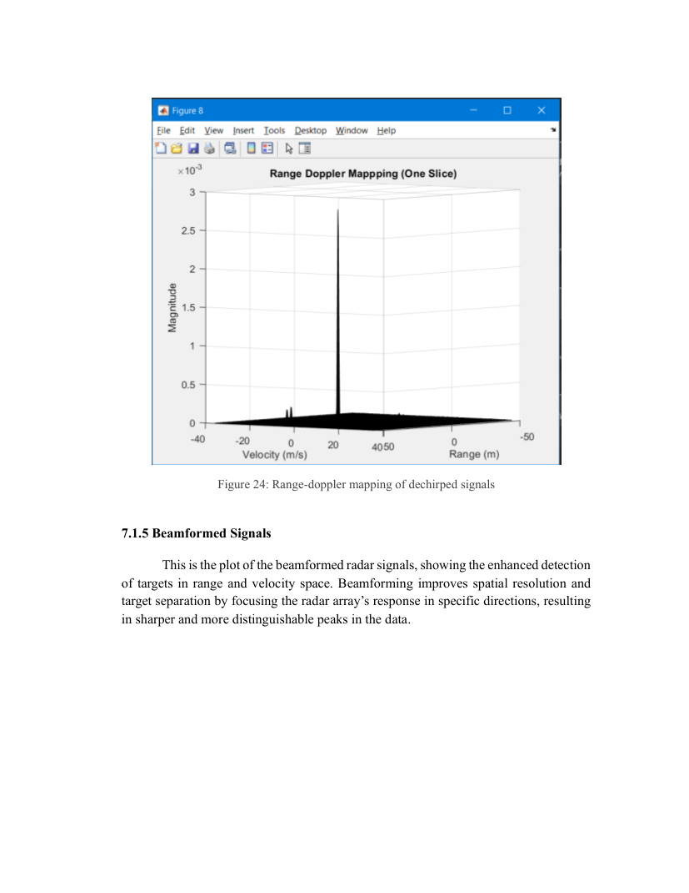
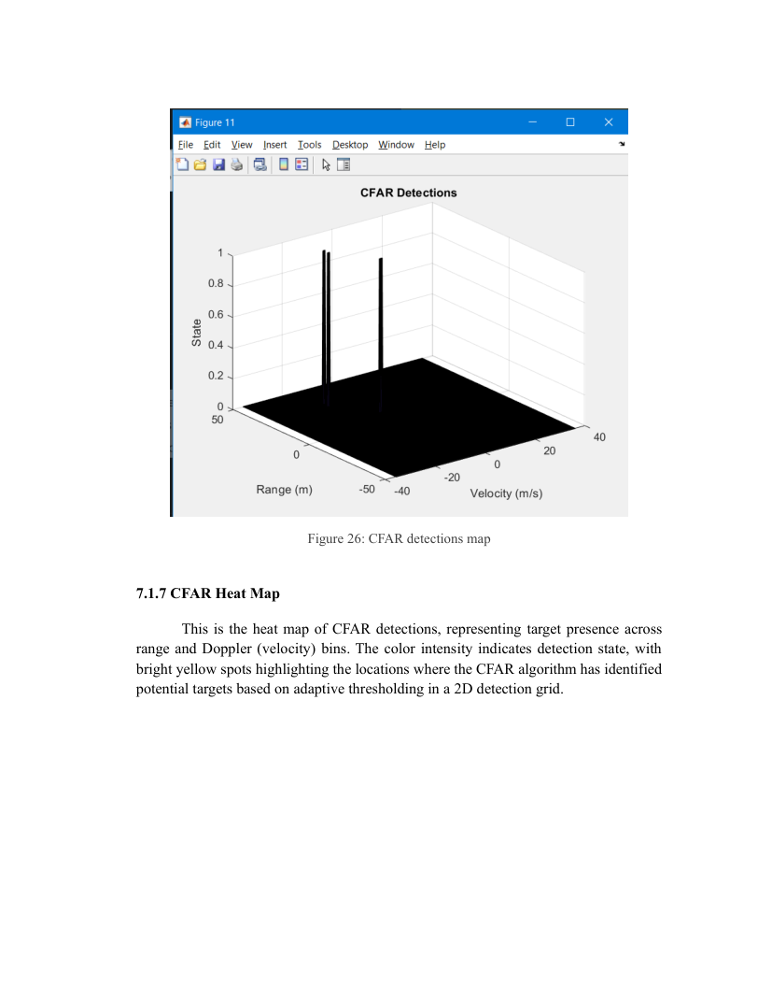

# Results and discussion

**Primary sources:** Thesis Chapter 7 (approximately PDF pages 59–73), Chapter 8.

## End-to-end MATLAB visualization

Chapter 7 illustrates transmitted, received and mixed/dechirped signals; range–Doppler maps; beamformed maps; CFAR detections/thresholds; and clustering. The reproduced images below are **document-page renders from the thesis**, not replotted results.

## Environmental variation

As summarized in §6.2, increased range, rain and higher noise figure reduced SNR in the simulated scenes; the earth-surface scenario is described as producing **no detections**. This failure case is relevant, not something to conceal. The supplied PDF does not support a complete numerical plot of performance against rainfall intensity or false-alarm probability without original datasets.

## RTL target estimation (transcribed from report narrative)

| Case | Reference targets | Reported detection/estimate observations |
| --- | --- | --- |
| 1 | 50 m, 20 m/s | 48.83–52.73 m; 18.24–22.80 m/s |
| 2 | 50 m, 20 m/s; 70 m, 40 m/s | First cluster near 50.78 m / 22.80 m/s; second near 70.31–72.27 m / 41.03 m/s |

The multiple reported detections per target reflect nearby bins or peaks, not necessarily multiple physical objects. Error magnitudes should be evaluated against the range/Doppler discretization and the exact ground-truth definition.

## Vivado resources from thesis §7.2.3

| Resource | Synthesis used | Capacity | Synthesis utilization | Implementation used | Implementation utilization |
| --- | ---: | ---: | ---: | ---: | ---: |
| LUT as logic | 29,000 | 63,400 | 45.74% | **265,000*** | 41.80% |
| LUT as memory | 5,000 | 19,000 | 26.31% | **45,000*** | 23.68% |
| Flip-flop registers | 23,500 | 126,800 | 18.53% | **23,000*** | 18.13% |
| Block RAM tiles | 127 | 135 | 94.07% | 119 | 88.15% |
| DSP slices | 218 | 240 | 90.83% | 210 | 87.50% |

**Asterisks mark unresolved source inconsistencies.** The implementation table's printed 265,000 logic LUTs and 45,000 memory LUTs exceed the listed capacity and do not match the printed percentages. The register row is also not perfectly arithmetically consistent. These appear to be transcription or formatting errors in the original report; no correction is assumed without raw Vivado reports.

## Interpretation

- High utilization of BRAM and DSPs in the reported synthesis points to memory and multiplier capacity as engineering constraints.
- Reported range/Doppler detections are close to their expected targets in the two RTL scenarios.
- Fixed-point feasibility is discussed through a Q-format model, but independent confirmation would require the original files and numerical data.
- No real-road test dataset or independently verified cross-modality sensor benchmark is supplied with the thesis. The document's broader statements comparing radar to cameras/ultrasound should be understood as literature-supported motivations and simulation discussion, not new field trial results in this repo.

## Limitations of this GitHub edition

No source simulations or FPGA implementations were executed to create this project package. All quoted performance figures are drawn from the PDF. See [Reproducibility](09_source_availability_and_reproducibility.md).
