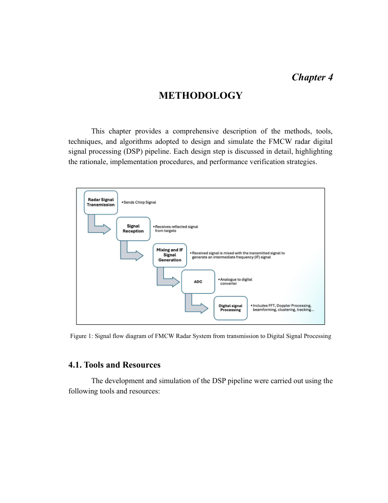
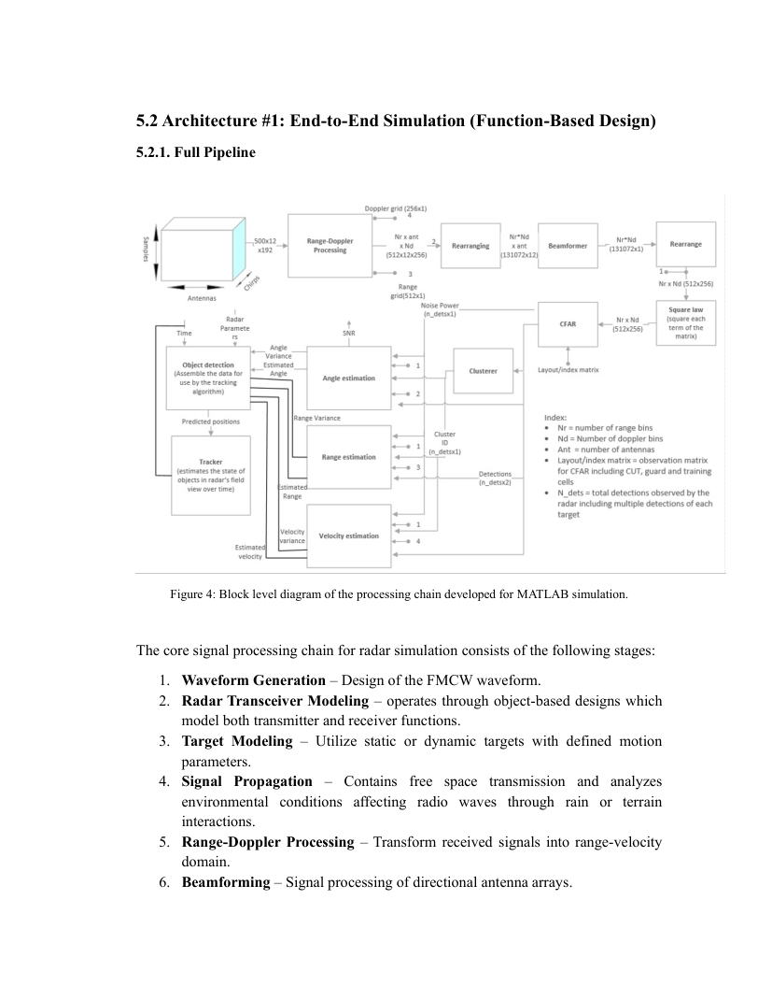
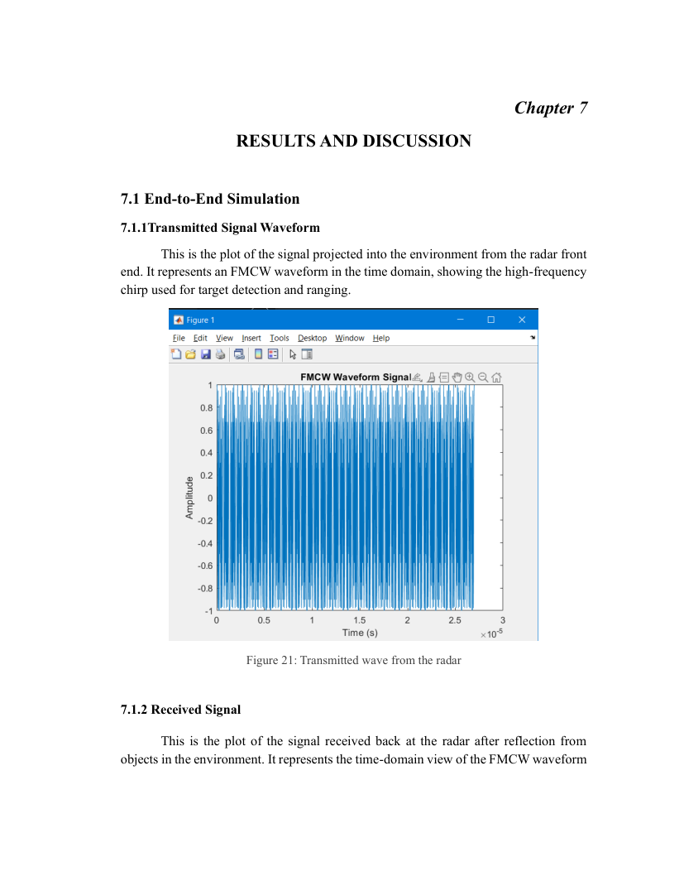
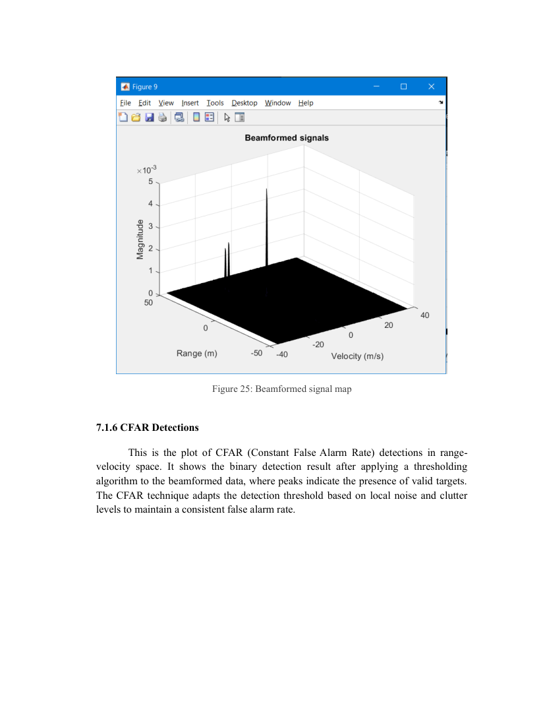
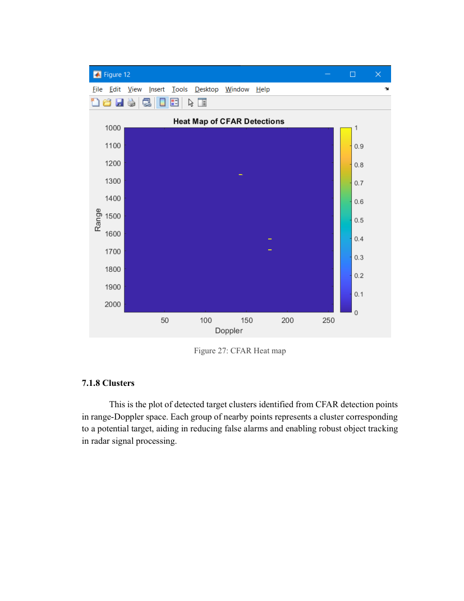
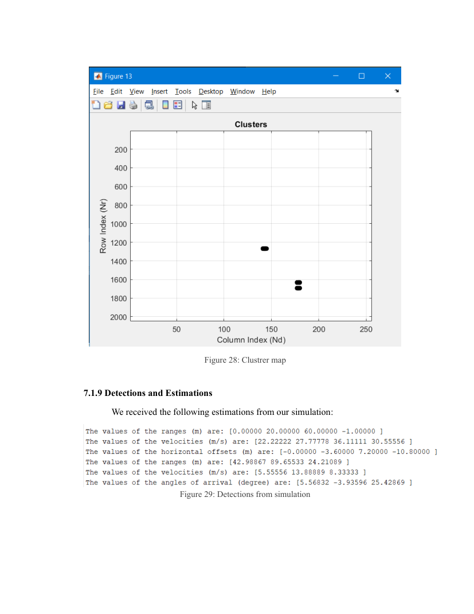
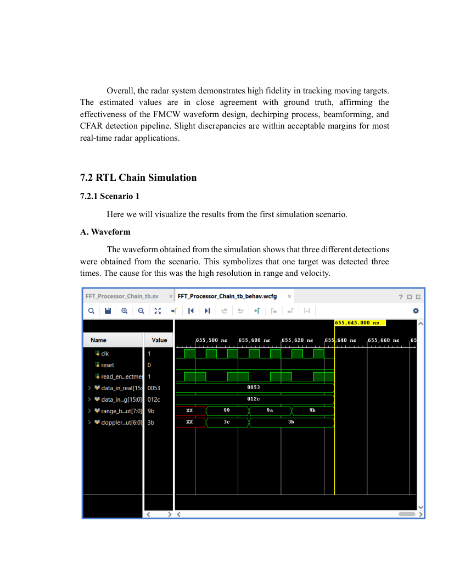
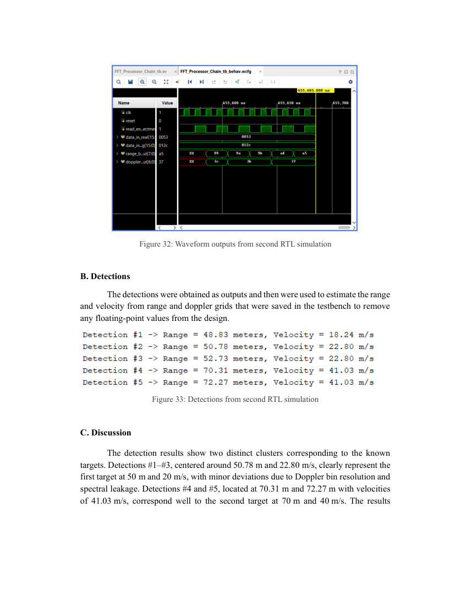
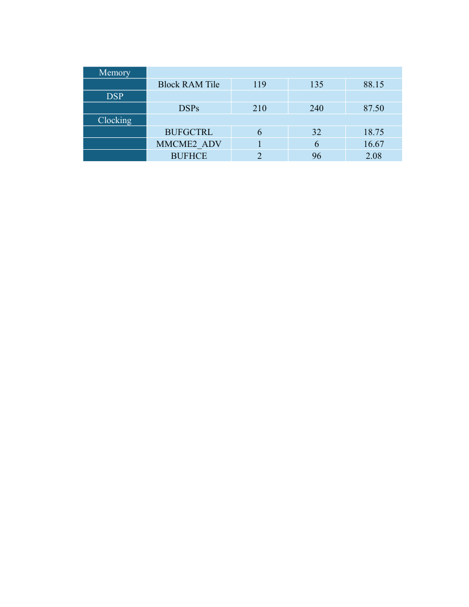
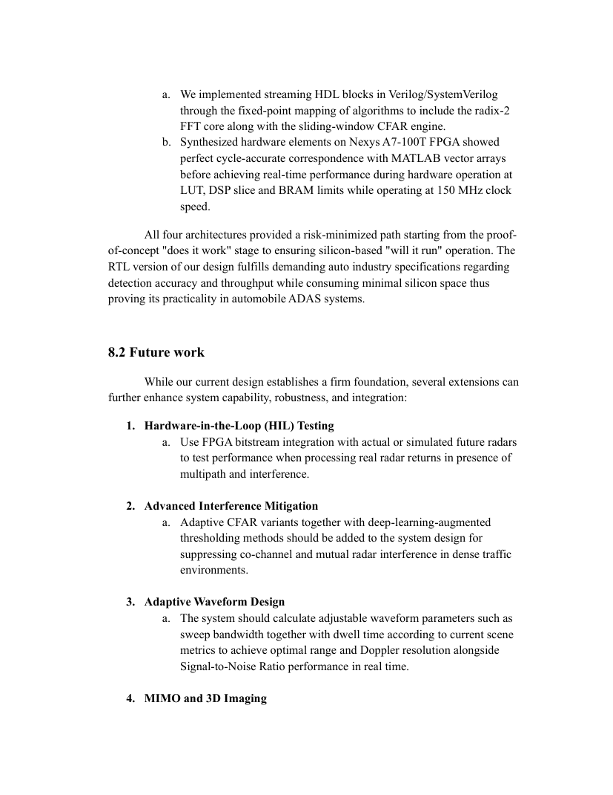

# Figure and diagram gallery

These are **PNG screenshots of pages from the original thesis PDF**, not original editable plot data. They may include surrounding captions/text. Page numbers refer to PDF pages, not necessarily internal numbered figure labels.

### 01 System Signal Flow — PDF page 12

### 02 Development Process — PDF page 19

### 03 End To End Processing Pipeline — PDF page 24

### 04 Range Doppler Fft Block — PDF page 25

### 05 Beamforming Block — PDF page 28

### 06 Cfar Detection Block — PDF page 29

### 07 Clustering Block — PDF page 31

### 08 Floating Point Chain — PDF page 36

### 09 Fixed Point Chain — PDF page 40

### 10 Transmitted Waveform — PDF page 59

### 11 Mixed Signal — PDF page 61

### 12 Range Doppler Map — PDF page 62

### 13 Beamformed Map — PDF page 63

### 14 Cfar Detection — PDF page 64

### 15 Cfar Heatmap — PDF page 65

### 16 Clustering Results — PDF page 66

### 17 End To End Estimation — PDF page 68

### 18 Rtl Results — PDF page 70

### 19 Rtl Results Second Scenario — PDF page 72

### 20 Fpga Utilization — PDF page 74

